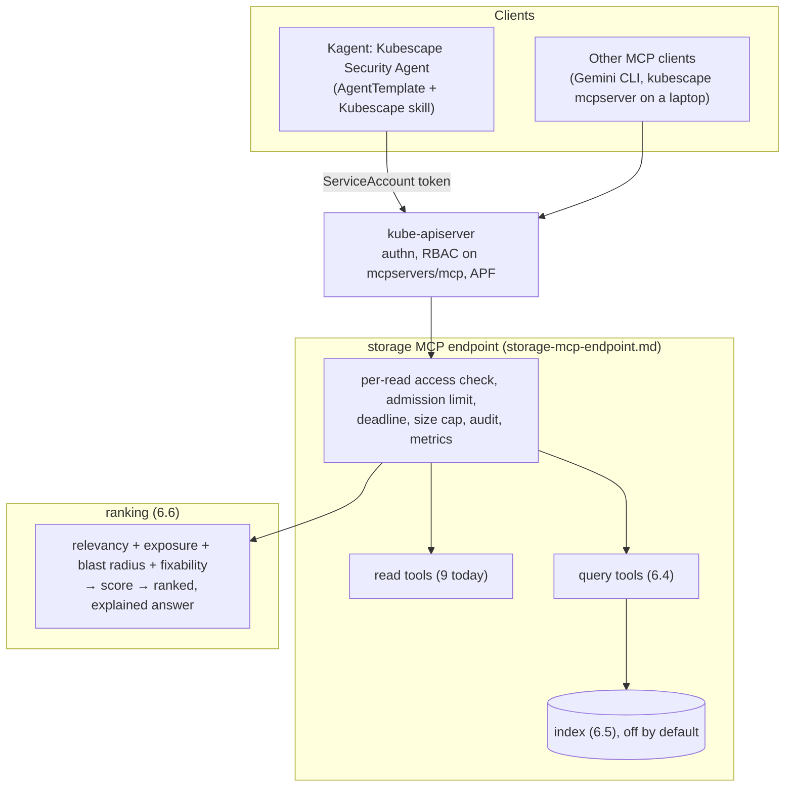

# Proposal: Fix What Matters, runtime-proven risk ranking and a security agent for Kubescape

- **Status:** Draft
- **Author:** Sarthak Shreshtha ([@Sarthak-Shreshtha01](https://github.com/Sarthak-Shreshtha01))
- **Date:** 2026-11-13
- **Scope:** [`kubescape`](https://github.com/kubescape/kubescape) (ranking, MCP tools), [`storage`](https://github.com/kubescape/storage)
  (query layer and index, MCP endpoint tools), [`helm-charts`](https://github.com/kubescape/helm-charts) (values, roles,
  Kagent agent), [`kubescape.io`](https://github.com/kubescape/kubescape.io) (guides)
- **Roadmap:** item 5.1, Kagent and MCP support; item 1.1, API hardening (the MCP surface)
- **Builds on:** [`storage-mcp-endpoint.md`](storage-mcp-endpoint.md) (the in-cluster MCP endpoint)
- **Related:** [`attack-path-analysis.md`](attack-path-analysis.md) (attack paths, a separate engine this proposal does
  not duplicate), [kubescape#4200](https://github.com/kubescape/kubescape/issues/4200) (summary-first scan tools),
  [kagent#3662](https://github.com/kagent-dev/kagent/issues/3662) (custom CA for `RemoteMCPServer`)

## 1. Summary

A cluster has thousands of vulnerabilities and posture findings, sorted only by severity. Most of them can never be
exploited: the vulnerable package is never loaded, the workload cannot be reached, or it has no permissions worth
taking. Kubescape already knows which ones are which, but the signals live in different places and no agent can join
them.

This proposal adds one question Kubescape can answer, for people and for AI agents: **"What should I fix first, and
why?"** The answer is a short ranked list. Every item carries the evidence behind its rank: loaded at runtime,
reachable from where, what its ServiceAccount can do, and whether a fix exists.

It has three parts:

1. **A ranking** that joins four signals Kubescape already collects (runtime relevancy, exposure, blast radius,
   fixability) into one explainable score.
2. **Query tools** on the MCP surface that answer cluster-wide questions in one call ("top fixable critical CVEs loaded
   at runtime", "which workloads have CVE-X"), instead of an agent fetching every report.
3. **The Kubescape Security Agent**: a ready-made Kagent agent with a Kubescape skill, read-only access through the
   storage endpoint, and a structured daily briefing, behind one Helm value.

Everything is read-only, scoped by the caller's own RBAC, and off by default.

## 2. Motivation

### The problem

Measured on a kind cluster with the operator chart and two scanned images (nginx:1.27, redis:7.4), using the 9 read
tools that `kubescape mcpserver` and the storage endpoint serve:

| Question an agent gets | Calls today | Data read | Grows with |
|---|---|---|---|
| "Top critical CVEs in the cluster" | 3 | 13.5 KB, 48 matches, 32 unique CVEs, severity only | 1 + images × pages |
| "Which images ship openssl?" | 4 | 1.5 KB | 1 + SBOMs |
| "What should I fix first?" | not possible | no runtime, exposure or permission signal is reachable by an in-cluster agent | |

With a few hundred images the first question is hundreds of calls and megabytes of context, and the answer is still
ordered by severity alone.

The roadmap names this gap in item 5.1: *"The hard part is data shaping rather than protocol ... the exposed surface
needs query and filter semantics, comparable to the filtering the UI already performs over the same data."*

### Why Kubescape can do this and image scanners cannot

Runtime relevancy is Kubescape's differentiator: node-agent records which packages a container actually loads, and
storage keeps the vulnerabilities filtered to them. An image-only scanner cannot tell a loaded critical CVE from an
unused one. Joining relevancy with reachability and permissions puts that differentiator at the centre of every answer.

## 3. Words used in this proposal

| Word | Meaning here |
|---|---|
| **Finding** | One vulnerability in one package of one workload's container, or one failed control on one resource. |
| **Relevant** | The vulnerable package was loaded by the container at runtime (node-agent's relevancy data). |
| **Exposure** | Who can reach the workload: from outside the cluster (Service, Ingress, Gateway), from any pod, from some pods, or none. |
| **Blast radius** | What the workload's ServiceAccount can do if the workload is taken over. |
| **Signal** | One of relevancy, exposure, blast radius, fixability, each with the value `yes`, `no` or `unknown`. |
| **Explanation** | The list of signals behind a rank, each with the Kubescape object it came from. |

## 4. Current state (checked against kubescape master `8ab01ea5` and storage main `b15ceb6d`)

| Signal | Where it is computed today | Reachable by in-cluster agents? |
|---|---|---|
| Runtime relevancy | node-agent; storage keeps workload-level `VulnerabilityManifest`s with `kubescape.io/context=filtered` and `SBOMSyftFiltered` | Partly: the manifests are listable through the endpoint, but no tool uses the filtered context as a signal |
| Exposure (in-cluster) | `core/pkg/networkpolicy` (NetworkPolicy index, `Exposure` levels) | No: CLI only (`analyze_vulnerability_exposure`) |
| Exposure (external) | `core/pkg/exposure` (LoadBalancer, NodePort, externalIPs, Ingress, HTTPRoute, GRPCRoute) | No: CLI only |
| Joining exposure and CVEs | `core/pkg/vulnexposure.Correlate`: sorts findings by external exposure, then NetworkPolicy exposure, then severity | No: CLI only |
| Blast radius | `core/pkg/rbacgraph` (escalation paths, cluster-admin reachable or not), `core/pkg/attackpath` (workload → ServiceAccount identity) | No: CLI only (`analyze_rbac_escalation_paths`) |
| Fixability | every `VulnerabilityManifest` (`vulnexposure.FixAvailable`) | Yes, per manifest |
| Hardening from runtime | `get_configuration_drift` (ContainerProfile vs manifest) | No: CLI only |
| Summaries on a default install | `VulnerabilitySummary`, `VulnerabilityManifestSummary`, `WorkloadConfigurationScanSummary` | No tool reads the vulnerability summaries; with `continuousScan: disable` (chart default) the full configuration scans behind `get_configuration_security_scan_manifest` are not stored |

So the parts exist. What is missing is the join with relevancy and blast radius, a score that explains itself, and a
way for an agent in the cluster to ask for it.

## 5. Goals and non-goals

### Goals

- One call answers "what should I fix first" for a namespace or the cluster, with a fixed size budget (a few KB).
- Every ranked item explains itself; nothing is a black box.
- A signal the caller may not read is `unknown`, never guessed and never leaked (section 6.7).
- The score is simple, documented, configurable, and pinned by a test scenario in CI.
- Cluster-wide query tools replace "list everything, then fetch each one".
- A working security agent from one Helm value, on Kagent 1.0 features only.
- Before/after numbers from a benchmark of real questions, kept in CI as size budgets.

### Non-goals

- An attack-path engine. [`attack-path-analysis.md`](attack-path-analysis.md) owns multi-hop paths; this proposal uses
  the existing `rbacgraph` result per ServiceAccount and can add attack-path results later if that engine lands.
- Summary-first output for the scan tools ([kubescape#4200](https://github.com/kubescape/kubescape/issues/4200)).
- VEX ingestion, runtime event history or forensics.
- Anything that changes the cluster. Hardening is returned as a patch for a human to review.

## 6. Proposed design

### 6.1 Big picture



### 6.2 The four signals

Each signal is computed per (workload, container) and has the value `yes`, `no` or `unknown`, plus the objects it came
from.

| Signal | `yes` when | `unknown` when | Source |
|---|---|---|---|
| **relevant** | the CVE is in the workload's filtered manifest (`kubescape.io/context=filtered`) | relevancy is disabled, the profile is not complete yet, or the caller may not read the manifest | storage |
| **exposure** | `external` (a Service, Ingress or Gateway route reaches it), else `open` / `restricted` / `isolated` from the NetworkPolicy index | the caller may not read Services, Ingresses, routes or NetworkPolicies in the namespace | `core/pkg/exposure`, `core/pkg/networkpolicy` |
| **blast radius** | `cluster` (the ServiceAccount reaches cluster-admin), `namespace` (it can read Secrets, or create pods or workloads, in a namespace), else `none` | the caller may not read the RBAC objects involved | `core/pkg/rbacgraph`, `core/pkg/attackpath` |
| **fixable** | grype reports a fixed version (`vulnexposure.FixAvailable`) | never: it is in every manifest | storage |

### 6.3 The score

The score is a sum of points, one table, returned with every item:

| Factor | Points |
|---|---|
| Severity | Critical 40, High 30, Medium 15, Low 5, other 0 |
| Relevant | yes 30, unknown 15, no 0 |
| Exposure | external 25, open 15, restricted 5, isolated 0, unknown 10 |
| Blast radius | cluster 25, namespace 15, none 0, unknown 8 |
| Fixable | yes 10, no 0 |

- `unknown` sits in the middle, so missing data neither hides a finding nor promotes it.
- Ties are broken by severity, then by CVE ID and workload name, so the order is stable.
- The points are defaults in a config map. Users can change them; the answer always states which weights were used.
- A golden scenario in CI pins the ranking: a fixed set of workloads (exposed + loaded + privileged, internal + not
  loaded + harmless, and the mixes in between) whose expected order is checked on every change.

A weighted sum was chosen over a strict tier order (relevant first, then exposure, ...) because a tier order lets one
`unknown` decide everything, and because a sum is easy to show next to each item.

### 6.4 The tools

New tools, all read-only, all with the query contract below.

| Tool | Answers | Default size |
|---|---|---|
| `what_to_fix_first` | Ranked findings for a namespace or the cluster, with explanations | top 10 |
| `explain_workload_risk` | Every signal for one workload, with the objects behind it | one workload |
| `top_vulnerabilities` | Cluster-wide CVEs by severity, fixability and relevancy | top 20 |
| `find_workloads_by_cve` | Workloads with a CVE, and whether it is loaded there | 50 |
| `find_workloads_by_package` | Workloads whose image ships a package (name, optional version range) | 50 |
| `failing_resources_by_control` | Resources failing a control, from the summaries a default install stores | 50 |
| `workload_overview` | Vulnerabilities, configuration result, profile and generated policies of one workload | one workload |
| `changes_since` | New loaded critical CVEs and newly failing controls since a cursor | 50 |

**Query contract** (the same for every new tool, and the shape the existing tools already return since
kubescape#4187): `filter` arguments per tool, `limit` with a documented maximum, `offset` or `continue`, and always
`total`, `returned` and `truncated` in the answer. Long text fields only on request (`include_details`).

**Example answer** of `what_to_fix_first` (shape only):

```json
{
  "scope": {"namespace": "shop"},
  "weights": "default",
  "total": 1243, "returned": 2, "truncated": true,
  "items": [
    {
      "rank": 1, "score": 120,
      "workload": {"namespace": "shop", "kind": "Deployment", "name": "checkout", "container": "app"},
      "finding": {"type": "vulnerability", "id": "CVE-2026-0001", "package": "openssl", "version": "3.0.2", "severity": "Critical"},
      "signals": {
        "relevant":     {"value": "yes", "from": "vulnerabilitymanifests/kubescape/deployment-checkout-app-..."},
        "exposure":     {"value": "external", "via": ["Ingress shop/shop -> Service shop/checkout:443"]},
        "blast_radius": {"value": "namespace", "via": ["Role shop/app-secrets: get secrets"]},
        "fixable":      {"value": "yes", "fixed_in": ["3.0.7"]}
      }
    },
    {
      "rank": 2, "score": 85,
      "workload": {"namespace": "shop", "kind": "Deployment", "name": "worker", "container": "worker"},
      "finding": {"type": "vulnerability", "id": "CVE-2026-0002", "package": "libxml2", "severity": "High"},
      "signals": {
        "relevant": {"value": "yes"}, "exposure": {"value": "isolated"},
        "blast_radius": {"value": "unknown", "reason": "no permission to read RBAC objects"}, "fixable": {"value": "yes"}
      }
    }
  ]
}
```

### 6.5 The index

Cluster-wide questions cannot decode every report on every call. Storage keeps a small index next to its SQLite
metadata, filled when a `VulnerabilityManifest`, `SBOMSyft` or `WorkloadConfigurationScanSummary` is saved:

- rows: (namespace, object name, workload, container, CVE, package, version, severity, fix state, relevant) and
  (namespace, resource, control, status, severity);
- filled after the write is stored, from a bounded queue, so writes are never slowed down; rebuilt at start-up;
- off by default (`storage.mcp.index.enabled`), with metrics (queue length, rows, rebuild time);
- the PR that adds it carries a write-path load test, as the admission limit did.

Reads through the index keep the endpoint's per-namespace access check: rows are filtered by the namespaces the caller
may read before anything is returned.

### 6.6 Where the ranking runs

The ranking needs Services, Ingresses, Gateway routes, NetworkPolicies and RBAC objects, which storage does not hold,
and the code that analyses them lives in `kubescape/core/pkg`. kubescape imports storage, so storage cannot import that
code back.

| Option | How | For | Against |
|---|---|---|---|
| **A. In the CLI first** | `what_to_fix_first` and `explain_workload_risk` in `kubescape mcpserver`, built on `vulnexposure.Correlate`, `rbacgraph` and the filtered manifests | No new permissions anywhere; reuses the analysis code as it is; ships first | Laptop only |
| **B. In the in-cluster kubescape deployment** | The same code served by the kubescape deployment, which already reads the cluster for scans, behind kube-apiserver like the storage endpoint | No new permissions for storage; one copy of the code | A second endpoint for agents, with its own access checks |
| **C. In storage** | Move `exposure`, `networkpolicy` and `rbacgraph` into a module both repos import; storage reads the objects with a read-only role | One endpoint for agents | Larger move; storage gains cluster read permissions, which the roadmap 1.1 review must accept |

**Proposed:** A first, so the ranking and its golden scenario are proven on real clusters without new permissions.
Then B or C, decided with the maintainers using the benchmark numbers. Either way the ranking code is one package with
the signals as inputs, so where it runs does not change it.

### 6.7 Access control

- The caller reaches the tools exactly as today: `create` on `mcpservers/mcp` in a namespace, then a per-read access
  check for every object a tool reads (storage-mcp-endpoint.md, section 6.5).
- A signal is computed only from objects the caller may read. If the caller may not read RBAC objects in `shop`,
  `blast_radius` is `unknown` with the reason. The explanation never names an object the caller could not have read.
- The chart's optional reader roles grow by one role for the signal inputs (Services, Ingresses, routes,
  NetworkPolicies, Roles and bindings: `get` and `list` only), bound separately so operators choose.

### 6.8 The Kubescape Security Agent

Built only from Kagent 1.0 features (`kagent.dev/v1alpha3`):

| Part | Kagent feature | What ships |
|---|---|---|
| The agent | `AgentTemplate` and `Agent` | A security agent bound only to the endpoint's read tools |
| Its know-how | Agent skills | The **Kubescape skill**: playbooks for fix-first triage, explaining one workload, hardening from runtime, what changed, compliance questions |
| Its access | `RemoteMCPServer` through kube-apiserver | Its own ServiceAccount, bound to the reader roles namespace by namespace |
| Its safety | Read-only tools; `RequireApproval` on any future action | It cannot change the cluster |
| Its report | `OutputSchema` | A structured briefing (top risks with evidence, quick wins, what changed) other tools can read |

It is off by default:

```yaml
# helm-charts: charts/kubescape-operator/values.yaml (proposed)
kagent:
  securityAgent:
    enabled: false
    namespaces: []          # namespaces it may read; empty means the release namespace only
    model: ""               # the Kagent ModelConfig to use
```

`RemoteMCPServer` cannot trust a custom CA today, and Kagent's gateway verifies upstream certificates itself
([kagent#3662](https://github.com/kagent-dev/kagent/issues/3662), where we offered the change). Until that lands the
agent runs on the Gemini CLI path documented in storage's endpoint docs; the chart value stays off.

### 6.9 Hardening from runtime

`explain_workload_risk` includes, when a complete ContainerProfile exists, the configuration drift the CLI already
computes: "this container never writes to its root filesystem and never uses these capabilities", returned as a
JSON patch to review. Nothing is applied.

## 7. Evidence and measurements

The numbers in section 2 come from a kind cluster (Kubernetes v1.37.0, operator chart 1.42.0, continuous scanning on).
Before the first code PR, the same benchmark runs on 20 to 30 images:

| Measure | Today | Target |
|---|---|---|
| Calls for "what should I fix first in this cluster" | not possible ("top CVEs" alone is 1 + images × pages) | 1 |
| Bytes an agent reads for it | grows with the cluster | a few KB, fixed budget |
| Top findings shown with runtime, exposure and permission evidence | none | all |
| Benchmark questions answerable on a default install | configuration questions return nothing | all |
| Install to first ranked answer | build your own agent, prompt and RBAC | one Helm value, about 5 minutes |

The same run reports how many of the top 20 findings by severity are actually loaded and reachable, which is the
number that shows the value of the ranking.

## 8. Security considerations

- Read-only: no tool writes to the cluster or to storage.
- No widening of access: the ranking reads with the caller's identity and per-read checks (section 6.7).
- The index holds data storage already stores; it adds no new data and is off by default.
- New input shapes (filters, cursors) get fuzz tests, and every tool gets an allowed / denied / cross-namespace test.
- A threat model for the whole MCP surface is written as part of this work (roadmap 1.1).

## 9. Rollout

| Phase | What | Repos |
|---|---|---|
| 1. Foundations | One copy of the read tools (storage-mcp-endpoint.md phase 5); tools for the summaries a default install stores; `relevant_only` filters; generated network policies and seccomp profiles readable | kubescape, storage, helm-charts |
| 2. Query tools | Query contract; index; `top_vulnerabilities`, `find_workloads_by_cve`, `find_workloads_by_package`, `failing_resources_by_control`, `workload_overview` | storage |
| 3. Ranking | Signals package, score, golden scenario; `what_to_fix_first` and `explain_workload_risk` in `kubescape mcpserver` (option A) | kubescape |
| 4. Security Agent | Kubescape skill, agent template, chart values, briefing schema, agent evaluation; Kagent CA support upstream | helm-charts, kagent |
| 5. In-cluster ranking | Option B or C, decided with phase 3's numbers; `changes_since` | kubescape or storage |
| 6. Trust and docs | Threat model, authorization matrix, fuzzing, MCP case in CI, size budgets, kubescape.io guides | all |

Each phase ships on its own and is useful without the next one.

## 10. Test plan

- Unit tests per signal, including every `unknown` case.
- The golden scenario (section 6.3) checked in CI.
- Authorization matrix: every tool × (allowed, denied, other namespace), on the fake reader and on kind.
- Fuzz tests for filters and cursors.
- Write-path load test for the index (node-agent profile writes with and without the index).
- Benchmark and size budgets: the section 7 questions run in CI; a tool that grows past its budget fails.
- Agent evaluation: 15 to 20 scripted conversations, checking the agent picks the right tools and gives the right
  answer, run before chart releases.

## 11. Alternatives considered

| Alternative | Why not |
|---|---|
| Only add filters to the existing per-manifest tools | Still one call per image for cluster-wide questions, and no join of signals |
| Rank by severity and fixability only | That is what scanners already do; it ignores Kubescape's runtime data |
| Let the agent join the signals itself | Many calls, large context, and the result depends on the model; a ranking in code is testable and the same for every client |
| A separate service for the ranking | One more component to deploy and secure; options A to C reuse what is already deployed |

## 12. Open questions

1. Option B or C for the in-cluster ranking (section 6.6).
2. Index storage: a SQLite table next to the metadata, or in memory rebuilt at start-up.
3. Default weights, and whether they are a chart value or only a config map.
4. Whether the Security Agent lives in the operator chart or in its own chart.
5. Whether `blast_radius` should also use attack-path results once [`attack-path-analysis.md`](attack-path-analysis.md)
   ships, and how the two outputs are kept consistent.

## 13. References

- Roadmap items 5.1 and 1.1, kubescape/project-governance `ROADMAP.md`
- [`storage-mcp-endpoint.md`](storage-mcp-endpoint.md) and its implementation status
- `core/pkg/vulnexposure`, `core/pkg/exposure`, `core/pkg/networkpolicy`, `core/pkg/rbacgraph`, `core/pkg/attackpath`
  in kubescape
- [kagent-dev/kagent#3662](https://github.com/kagent-dev/kagent/issues/3662): custom CA for `RemoteMCPServer`
