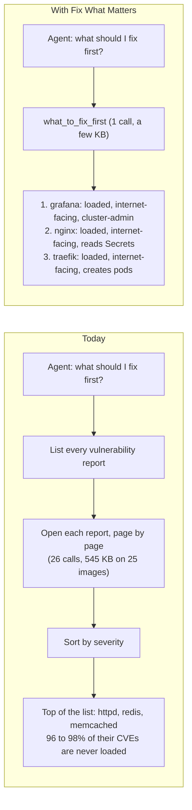
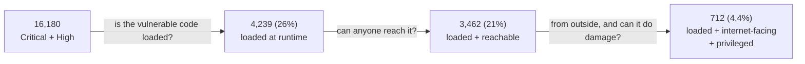
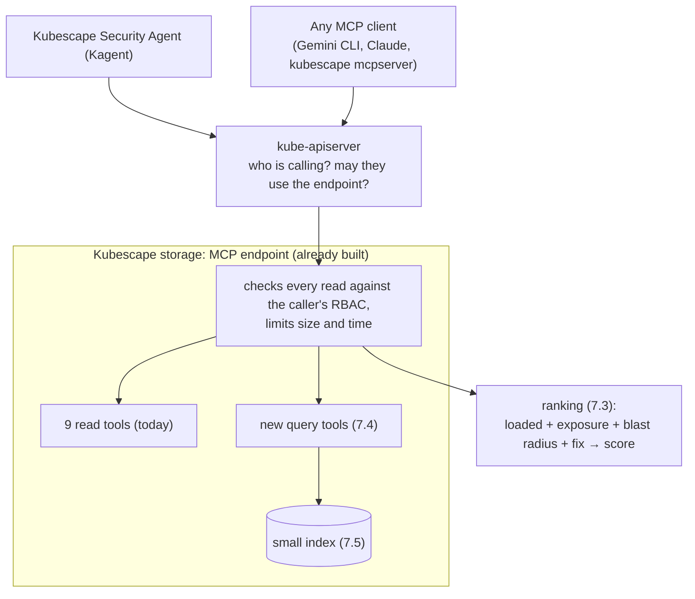
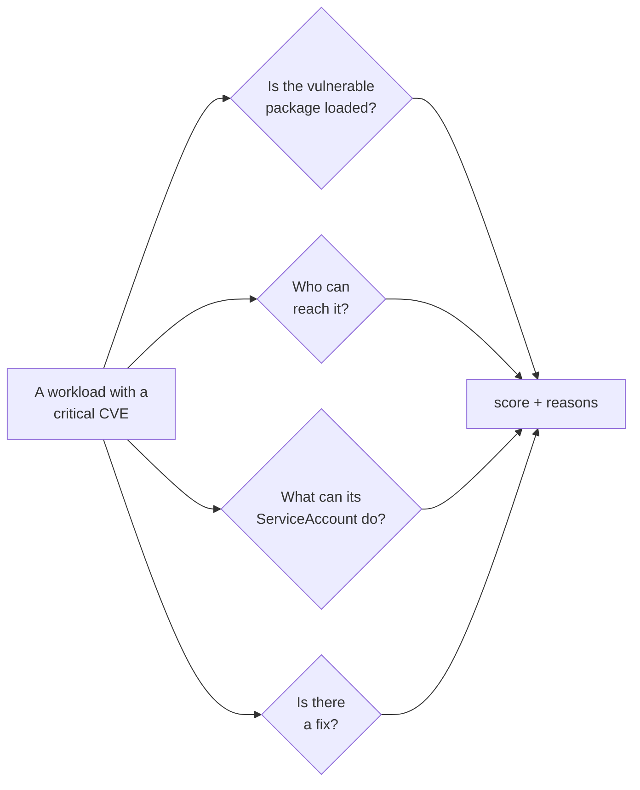
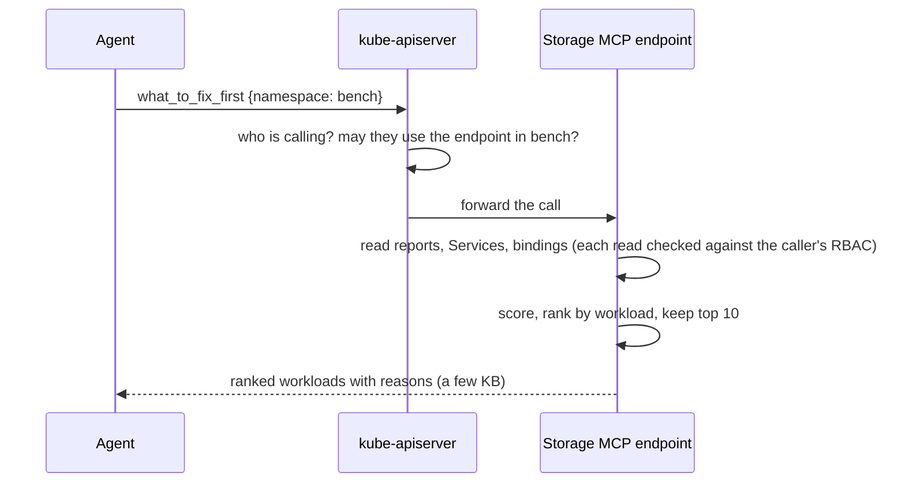
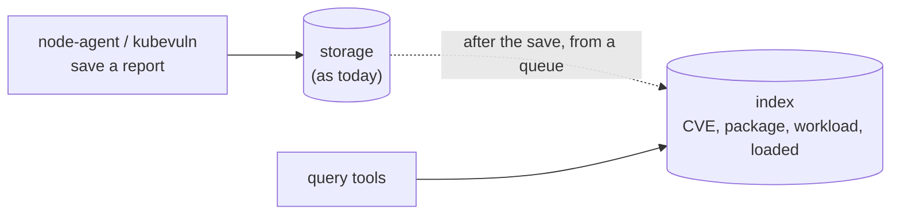
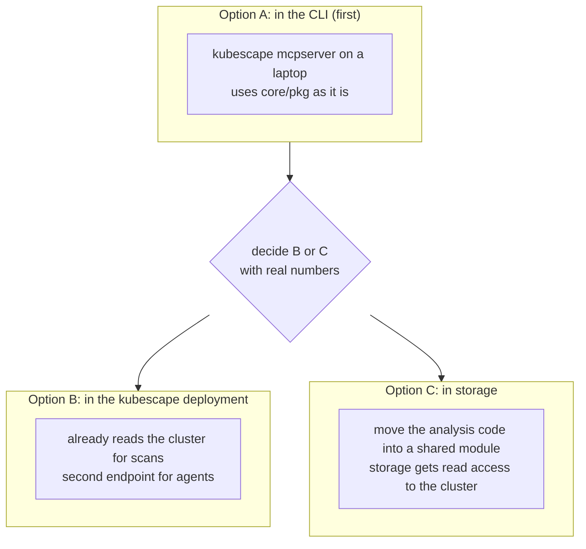
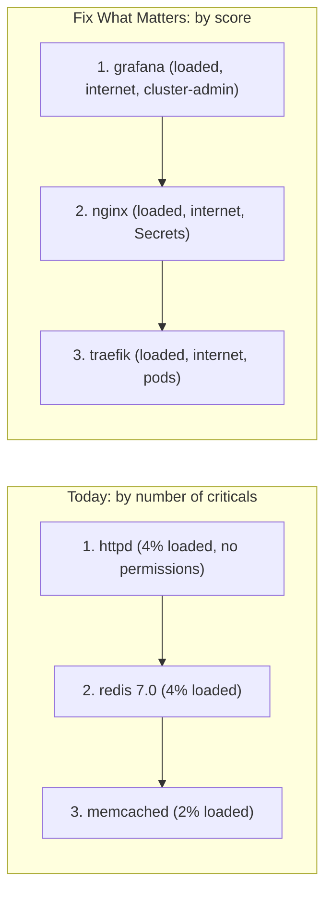
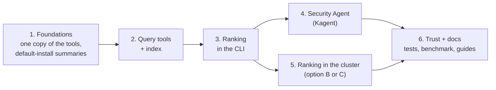

# Proposal: Fix What Matters, runtime-proven risk ranking and a security agent for Kubescape

- **Status:** Proposed
- **Author:** Sarthak Shreshtha ([@Sarthak-Shreshtha01](https://github.com/Sarthak-Shreshtha01))
- **Date:** 2026-11-13
- **Scope:** [`kubescape`](https://github.com/kubescape/kubescape) (ranking, MCP tools), [`storage`](https://github.com/kubescape/storage)
  (query tools and index), [`helm-charts`](https://github.com/kubescape/helm-charts) (values, roles, Kagent agent),
  [`kubescape.io`](https://github.com/kubescape/kubescape.io) (guides)
- **Roadmap:** item 5.1, Kagent and MCP support; item 1.1, API hardening (the MCP surface)
- **Builds on:** [`storage-mcp-endpoint.md`](storage-mcp-endpoint.md) (the in-cluster MCP endpoint)
- **Related:** [`attack-path-analysis.md`](attack-path-analysis.md) (attack paths: a separate engine, not duplicated
  here), [kubescape#4200](https://github.com/kubescape/kubescape/issues/4200) (summary-first scan tools),
  [kagent#3662](https://github.com/kagent-dev/kagent/issues/3662) (custom CA for `RemoteMCPServer`)

## 1. Summary

A cluster has thousands of vulnerabilities, sorted only by severity. Most of them can never be used by an attacker:
the vulnerable code is never loaded, nobody can reach the workload, or the workload has no permissions worth taking.
Kubescape already knows which is which. It just never puts the pieces together.

This proposal lets Kubescape answer one question, for people and for AI agents:

> **"What should I fix first, and why?"**

The answer is a short ranked list of workloads. Each one says **why** it is on the list: the vulnerable code is loaded,
someone outside can reach it, its ServiceAccount can do damage, and a fix exists.

It has three parts:

1. **A ranking** that joins four checks Kubescape already does into one simple score.
2. **Query tools** that answer cluster-wide questions in one call, instead of an agent opening every report.
3. **The Kubescape Security Agent**: a ready-made Kagent agent that uses these tools, behind one Helm value.

Everything is read-only, limited by the caller's own RBAC, and off by default.

### Before and after, in one picture



## 2. The problem

### People and agents drown in findings

We set up a kind cluster with 25 workloads running 25 common images (section 8) and asked the questions a security
engineer asks, using the 9 read tools that `kubescape mcpserver` and the storage endpoint serve today:

| Question | Calls today | Data the agent reads |
|---|---|---|
| "Top critical CVEs in the cluster" | 26 | 545 KB |
| "Which workloads have CVE-2026-5450?" | 26 | 74 KB |
| "Which resources fail control C-0016?" | 129 | 283 KB |
| "Which images ship openssl?" | 26 | 12 KB |
| "What should I fix first?" | **not possible** | no tool gives runtime, reachability or permission data |

Every number grows with the cluster. With a few hundred images, one question is hundreds of calls and megabytes of
text: more than an agent can read, and the answer is still sorted by severity alone.

### Most of those findings do not matter

On the same cluster, out of 16,180 Critical and High findings:



**Only 4.4% are worth fixing first.** Today Kubescape shows all 16,180, ordered by severity.

The roadmap names this gap in item 5.1: *"The hard part is data shaping rather than protocol ... the exposed surface
needs query and filter semantics, comparable to the filtering the UI already performs over the same data."*

### Why Kubescape, and not an image scanner

Runtime relevancy is what sets Kubescape apart: node-agent records which packages a container actually loads. An image
scanner only sees the image, so it cannot tell a loaded critical CVE from an unused one. This proposal puts relevancy at
the centre of every answer.

## 3. Before and after: one conversation

The agent's words below are illustrative; the calls, sizes and numbers are from our kind cluster.

**Today**, an agent connected to Kubescape's tools:

> **User:** What should I fix first?
>
> **Agent:** *(calls `list_vulnerability_manifests`, then `list_vulnerabilities_in_manifest` 25 times, reads 545 KB)*
> The images with the most critical CVEs are httpd (3,850 Critical/High), redis 7.0 (3,949) and memcached (3,699).
> I suggest upgrading those first.

That advice is wrong. Those three images load only 2 to 4% of their vulnerable packages, and none of them has
permissions. Meanwhile grafana, which is reachable from outside the cluster and runs as cluster-admin, is 8th.

**With Fix What Matters:**

> **User:** What should I fix first?
>
> **Agent:** *(calls `what_to_fix_first` once, reads a few KB)*
> 1. **grafana**: 183 vulnerable packages are loaded at runtime (159 have a fix), it is reachable from outside through
>    a NodePort Service, and its ServiceAccount is cluster-admin. Upgrade the image first.
> 2. **nginx 1.25**: loaded, reachable from outside, its ServiceAccount can read Secrets in `bench`.
> 3. **traefik**: loaded, reachable from outside, its ServiceAccount can create pods.
>
> httpd, redis and memcached have many CVEs, but almost none of them are loaded and they have no permissions: patch
> them later.
>
> **User:** Why is grafana first?
>
> **Agent:** *(calls `explain_workload_risk`)* Each reason, with the Kubescape object it came from: the loaded-package
> report, the Service `bench/grafana`, the ClusterRoleBinding `bench-sa-admin`.

| | Today | After |
|---|---|---|
| Calls | 26 | 1 |
| Data read by the agent | 545 KB | a few KB |
| Ordered by | severity only | loaded, reachable, permissions, fix, severity |
| Says why | no | yes, with the objects behind each reason |
| Top 3 | httpd, redis, memcached (2 to 4% loaded, no permissions) | grafana, nginx, traefik (loaded, internet-facing, privileged) |

## 4. Words used in this proposal

| Word | Meaning |
|---|---|
| **Finding** | One vulnerability in one package of one workload. |
| **Loaded** (relevant) | The vulnerable package was loaded by the container when it ran (node-agent's relevancy data). |
| **Exposure** | Who can reach the workload: `external` (from outside the cluster), `open` (any pod), `isolated` (a NetworkPolicy blocks it). |
| **Blast radius** | What the workload's ServiceAccount can do if an attacker takes the workload over. |
| **Signal** | One of the four checks: loaded, exposure, blast radius, fixable. |

## 5. What exists today

The pieces exist. Nobody joins them, and in-cluster agents cannot reach most of them.

| Check | Where Kubescape has it today | Can an in-cluster agent use it? |
|---|---|---|
| Loaded at runtime | node-agent; storage keeps a "filtered" vulnerability report per workload (`kubescape.io/context=filtered`) | Partly: the report can be read, but no tool uses it as a signal |
| Exposure | `core/pkg/exposure` (Services, Ingress, Gateway routes) and `core/pkg/networkpolicy` | No, CLI only (`analyze_vulnerability_exposure`) |
| Exposure joined with CVEs | `core/pkg/vulnexposure.Correlate` | No, CLI only |
| Blast radius | `core/pkg/rbacgraph` (escalation paths), `core/pkg/attackpath` (workload → ServiceAccount) | No, CLI only (`analyze_rbac_escalation_paths`) |
| Fix available | every vulnerability report | Yes, one report at a time |
| Hardening from runtime | `get_configuration_drift` | No, CLI only |

(Checked against kubescape master `8ab01ea5` and storage main `b15ceb6d`.)

## 6. Goals and non-goals

**Goals**
- One call answers "what should I fix first" for a namespace or the whole cluster, in a few KB.
- Every item says why it is ranked there. No black box.
- If the caller may not read something, that signal is `unknown`. It is never guessed and never leaked.
- The score is simple, written down, configurable, and checked in CI.
- Cluster-wide questions take one call instead of "list everything, then open each one".
- A working security agent from one Helm value.

**Non-goals**
- An attack-path engine. [`attack-path-analysis.md`](attack-path-analysis.md) owns multi-step paths.
- Summary-first output for the scan tools ([kubescape#4200](https://github.com/kubescape/kubescape/issues/4200)).
- VEX, runtime event history, forensics.
- Anything that changes the cluster. Fixes are suggestions for a human to apply.

## 7. Design

### 7.1 Big picture



### 7.2 The four signals

For every workload, Kubescape answers four questions:



| Signal | Possible values | Example from our cluster | Where the answer comes from |
|---|---|---|---|
| **Loaded** | yes, no, unknown | grafana: 183 of 255 Critical/High packages loaded; httpd: 154 of 3,850 | the filtered vulnerability report |
| **Exposure** | external, open, isolated, unknown | grafana: NodePort Service → external; postgres 16: deny-all NetworkPolicy → isolated | Services, Ingress, routes, NetworkPolicies |
| **Blast radius** | cluster, namespace, none, unknown | grafana: cluster-admin → cluster; nginx: can read Secrets → namespace | RoleBindings, ClusterRoleBindings |
| **Fixable** | yes, no | grafana: 159 of the 183 loaded have a fixed version | the vulnerability report |

A signal is `unknown` when the data is not there yet (for example, the container is still being profiled) or when the
caller is not allowed to read it.

### 7.3 The score

Points for each signal, added up. One small table:

| Signal | Points |
|---|---|
| Severity | Critical 40, High 30, Medium 15, Low 5 |
| Loaded | yes 30, unknown 15, no 0 |
| Exposure | external 25, open 15, isolated 0, unknown 10 |
| Blast radius | cluster 25, namespace 15, none 0, unknown 8 |
| Fixable | yes 10, no 0 |

**Worked example**, two real findings from our cluster:

| | grafana: CVE-2024-45337 in golang.org/x/crypto | httpd: CVE-2026-111497 in libbrotli1 |
|---|---|---|
| Severity | Critical: 40 | Critical: 40 |
| Loaded | yes: 30 | no: 0 |
| Exposure | external (NodePort): 25 | external (NodePort): 25 |
| Blast radius | cluster-admin: 25 | none: 0 |
| Fixable | yes: 10 | yes: 10 |
| **Score** | **130** | **75** |

Both are Critical and both have a fix. grafana's package is loaded and grafana is cluster-admin; httpd never loads
libbrotli1 and has no permissions. Same severity, very different risk, and the score shows exactly why.

Rules:
- `unknown` gets middle points, so missing data neither hides a finding nor pushes it up.
- **Workloads are ranked, not single CVEs.** A workload's score is its best finding's score. Ranked one CVE at a time,
  grafana alone filled the whole top 20 in our run, but the fix is one action: upgrade grafana's image.
- Ties are broken by severity, then by name, so the order never jumps around.
- The points are defaults that users can change. The answer always says which points were used.
- A fixed test cluster in CI (exposed + loaded + privileged, isolated + unused + harmless, and the mixes in between)
  checks the order on every change.

### 7.4 The tools

| Tool | Question it answers | Default size |
|---|---|---|
| `what_to_fix_first` | What should I fix first in this namespace or cluster? | top 10 workloads |
| `explain_workload_risk` | Why is this workload ranked here? | one workload |
| `top_vulnerabilities` | What are the worst CVEs in the cluster (loaded, fixable, by severity)? | top 20 |
| `find_workloads_by_cve` | Which workloads have CVE-X, and is it loaded there? | 50 |
| `find_workloads_by_package` | Which workloads ship package Y? | 50 |
| `failing_resources_by_control` | Which resources fail control C-Z? (works on a default install) | 50 |
| `workload_overview` | Everything about one workload in one call | one workload |
| `changes_since` | What new loaded critical CVEs or failing controls appeared since yesterday? | 50 |

All tools are read-only and follow the same rules as the existing ones: a `limit`, paging, and always `total`,
`returned` and `truncated` in the answer.

**How one question flows:**



**Example answer** (shortened; numbers from our kind cluster):

```json
{
  "scope": {"namespace": "bench"},
  "weights": "default",
  "total": 23, "returned": 2, "truncated": true,
  "items": [
    {
      "rank": 1, "score": 130,
      "workload": {"namespace": "bench", "kind": "Deployment", "name": "grafana"},
      "reasons": {
        "exposure":     {"value": "external", "via": ["Service bench/grafana (NodePort)"]},
        "blast_radius": {"value": "cluster", "via": ["ClusterRoleBinding bench-sa-admin → cluster-admin"]}
      },
      "findings": {"critical_high": 255, "loaded": 183, "loaded_fixable": 159},
      "top_findings": [
        {"id": "CVE-2024-45337", "package": "golang.org/x/crypto", "severity": "Critical", "loaded": "yes", "fixable": "yes", "score": 130}
      ]
    },
    {
      "rank": 2, "score": 120,
      "workload": {"namespace": "bench", "kind": "Deployment", "name": "nginx125"},
      "reasons": {
        "exposure":     {"value": "external", "via": ["Service bench/nginx125 (NodePort)"]},
        "blast_radius": {"value": "namespace", "via": ["RoleBinding bench/sa-secrets → get, list secrets"]}
      },
      "findings": {"critical_high": 372, "loaded": 372, "loaded_fixable": 204}
    }
  ]
}
```

### 7.5 The index

To answer cluster-wide questions in one call, storage keeps a small table of "which workload has which CVE in which
package, how severe, fixable, loaded". It is filled **after** a report is saved, from a queue, so saving reports never
gets slower.



- Off by default (`storage.mcp.index.enabled`), rebuilt at start-up, with metrics.
- The PR that adds it includes a load test showing writes are not slowed down.
- Answers are still filtered by what the caller may read.

### 7.6 Where the ranking runs

The ranking needs Services, Ingresses, NetworkPolicies and RBAC objects, which storage does not hold, and the code that
reads them lives in `kubescape/core/pkg`. kubescape imports storage, so storage cannot import that code back.



| Option | Good | Not so good |
|---|---|---|
| **A. CLI first** | No new permissions anywhere; reuses existing code; ships first | Laptop only |
| **B. kubescape deployment** | No new permissions for storage | A second endpoint for agents |
| **C. storage** | One endpoint for agents | Bigger change; storage needs to read Services and RBAC (needs the roadmap 1.1 review) |

**Proposed:** start with A, prove the ranking on real clusters, then choose B or C together with the maintainers.
The ranking code is one package either way.

### 7.7 Who can see what

- Agents reach the tools exactly as today, through kube-apiserver, with every read checked against their RBAC.
- A signal uses only objects the caller may read. Example: an agent that may not read RBAC objects in `shop` gets
  `"blast_radius": {"value": "unknown", "reason": "no permission to read RBAC objects"}`, never the binding names.
- The chart's optional reader roles get one more role for Services, Ingresses, NetworkPolicies and RBAC objects
  (`get` and `list` only), bound separately so operators decide.

### 7.8 The Kubescape Security Agent

A ready-made Kagent agent, built only on Kagent 1.0 features:

| Part | Kagent feature | What it gives |
|---|---|---|
| The agent | `AgentTemplate`, `Agent` | A security agent that can use only Kubescape's read tools |
| Its know-how | Agent skills | A **Kubescape skill**: how to triage, explain a workload, harden from runtime, report what changed |
| Its access | `RemoteMCPServer` through kube-apiserver | Its own ServiceAccount, bound to reader roles per namespace |
| Its safety | Read-only tools; `RequireApproval` for any future action | It cannot change the cluster |
| Its report | `OutputSchema` | A structured daily briefing other tools can read |

Turning it on:

```yaml
# helm-charts: charts/kubescape-operator/values.yaml (proposed)
kagent:
  securityAgent:
    enabled: false          # off by default
    namespaces: [shop, payments]
    model: my-model-config  # the Kagent ModelConfig to use
```

Example daily briefing (illustrative shape):

```text
Kubescape security briefing, cluster prod, 2026-12-01
Fix first: grafana (loaded critical CVE, internet-facing, cluster-admin), nginx, traefik
Quick wins: 3 workloads need only an image upgrade to clear all loaded critical CVEs
New since yesterday: 2 loaded critical CVEs in payments/api; control C-0016 started failing on shop/web
```

`RemoteMCPServer` cannot trust a custom CA today ([kagent#3662](https://github.com/kagent-dev/kagent/issues/3662),
where we offered the change). Until then, the same tools work with the Gemini CLI as documented in storage's endpoint
docs, and the chart value stays off.

### 7.9 Hardening from runtime

`explain_workload_risk` also says how to make the workload safer, from what the container actually did. This is the
CLI's existing `get_configuration_drift`. For grafana on our cluster it returned:

```json
[{"YamlExpression": "select(di==0).spec.template.spec.containers[0].securityContext.capabilities.drop |= [\"ALL\"]"}]
```

In words: "grafana never used any Linux capability while it ran, so it can drop them all." It is returned as a patch
for a human to review. Nothing is applied.

## 8. Evidence: the measurement on kind

**Setup.** kind (Kubernetes v1.37.0), operator chart 1.42.0 with continuous scanning on, Kubescape storage with
kubescape#4875. 25 Deployments with 25 common images, mostly 2023 releases (nginx, httpd, traefik, caddy, grafana,
registry, tomcat, prometheus, redis, memcached, rabbitmq, postgres, mysql, mariadb, mongo, vault, python, node, alpine,
ubuntu, debian, busybox). They were set up so the signals differ:

- reachability: NodePort Services and Ingresses (external), plain Services (open), a deny-all NetworkPolicy
  (isolated), no Service;
- permissions: ServiceAccounts that can read Secrets, create pods, or are cluster-admin, and the default one;
- all containers fully profiled before the run (2026-11-13).

**Ranked by number of criticals (today) vs by the score:**

| Workload | Reachable | Permissions | Critical + High | Loaded | Rank today | Rank by score |
|---|---|---|---|---|---|---|
| grafana | external | cluster-admin | 255 | 183 | 8 | **1** |
| nginx 1.25 | external | reads Secrets | 372 | 372 | 7 | **2** |
| traefik | external | creates pods | 169 | 157 | 10 | **3** |
| httpd | external | none | 3,850 | 154 (4%) | 1 | 6 |
| redis 7.0 | open | none | 3,949 | 170 (4%) | 2 | 13 |
| memcached | open | none | 3,699 | 88 (2%) | 3 | 15 |
| postgres 16 | isolated | none | 442 | 348 | 6 | 21 |
| mongo | isolated | none | 203 | 170 | 13 | 22 |



Isolated databases with many loaded CVEs drop to the end. They still need patching, just not first.

**What the run taught us**
- Ranked one CVE at a time, grafana alone filled the top 20, so the design ranks workloads (7.3).
- For nginx, tomcat and rabbitmq the "loaded" report equals the full report: relevancy did not narrow those images.
  The other signals still rank them sensibly. Why relevancy keeps every package for these images is a node-agent
  question to follow up.

**Targets**

| Measure | Today | Target |
|---|---|---|
| Calls for "what should I fix first" | not possible ("top CVEs" alone: 26 calls, 545 KB) | 1 call |
| Data the agent reads | grows with the cluster | a few KB, fixed |
| Top items that say why (loaded, reachable, permissions) | none | all |
| Questions answerable on a default install | configuration questions return nothing | all |
| Install to first ranked answer | build your own agent, prompt and RBAC | one Helm value, about 5 minutes |

## 9. Security

- Read-only: no tool writes to the cluster or to storage.
- No extra access: the ranking reads as the caller, with every read checked (7.7).
- The index holds only data storage already has, and is off by default.
- Every tool is tested with an allowed caller, a denied caller and a caller from another namespace, and new arguments
  are fuzz-tested.
- A threat model for the whole MCP surface is written as part of this work (roadmap 1.1).

## 10. Rollout



| Phase | What | Repos |
|---|---|---|
| 1. Foundations | One copy of the read tools (kubescape#4875); tools for the summaries a default install stores; a `loaded only` filter; generated network policies and seccomp profiles readable | kubescape, storage, helm-charts |
| 2. Query tools | `top_vulnerabilities`, `find_workloads_by_cve`, `find_workloads_by_package`, `failing_resources_by_control`, `workload_overview`, and the index | storage |
| 3. Ranking | The signals, the score, the CI test cluster; `what_to_fix_first` and `explain_workload_risk` in `kubescape mcpserver` | kubescape |
| 4. Security Agent | Kubescape skill, agent template, chart values, briefing; Kagent CA support upstream | helm-charts, kagent |
| 5. Ranking in the cluster | Option B or C; `changes_since` | kubescape or storage |
| 6. Trust and docs | Threat model, access tests, fuzzing, CI benchmark with size limits, kubescape.io guides | all |

Each phase is useful on its own.

## 11. Test plan

- Unit tests for each signal, including every `unknown` case.
- The fixed test cluster (7.3) checks the ranking order in CI.
- Every tool × (allowed, denied, other namespace), on fake data and on kind.
- Fuzz tests for filters and paging.
- Load test: report saves with and without the index.
- Benchmark: the questions in section 2 run in CI; a tool whose answer grows past its size limit fails.
- Agent tests: 15 to 20 scripted conversations, checking the agent picks the right tools and gives the right answer.

## 12. Alternatives considered

| Alternative | Why not |
|---|---|
| Only add filters to the existing tools | Still one call per image for cluster-wide questions, and no "why" |
| Rank by severity and fix only | That is what every scanner does; it ignores Kubescape's runtime data |
| Let the agent combine the signals itself | Many calls, large context, and the answer changes with the model; code is testable and the same for everyone |
| A new service just for ranking | One more thing to deploy and secure; options A to C reuse what is already running |

## 13. Open questions

1. Option B or C for the ranking in the cluster (7.6).
2. The index: a table next to storage's metadata, or in memory rebuilt at start-up.
3. The default points, and whether users set them in the chart or in a config map.
4. Whether the Security Agent lives in the operator chart or its own chart.
5. Whether blast radius should also use attack-path results once [`attack-path-analysis.md`](attack-path-analysis.md)
   ships.

## 14. References

- Roadmap items 5.1 and 1.1, kubescape/project-governance `ROADMAP.md`
- [`storage-mcp-endpoint.md`](storage-mcp-endpoint.md) and its implementation status
- `core/pkg/vulnexposure`, `core/pkg/exposure`, `core/pkg/networkpolicy`, `core/pkg/rbacgraph`, `core/pkg/attackpath`
  in kubescape
- [kagent-dev/kagent#3662](https://github.com/kagent-dev/kagent/issues/3662): custom CA for `RemoteMCPServer`
