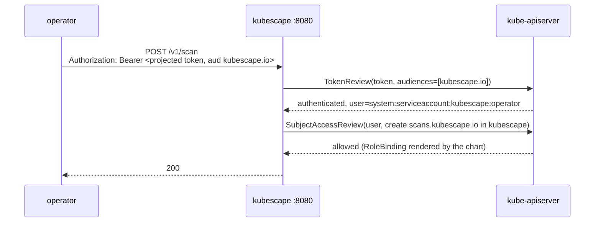

# Proposal: Authentication and authorization for Kubescape's in-cluster HTTP APIs

- **Status:** Proposed
- **Author:** Ben Hirschberg ([@slashben](https://github.com/slashben))
- **Date:** 2026-11-02
- **Scope:** [`storage`](https://github.com/kubescape/storage) (new shared package),
  [`kubescape`](https://github.com/kubescape/kubescape) (HTTP handler and the `operator scan` CLI command),
  [`kubevuln`](https://github.com/kubescape/kubevuln),
  [`synchronizer`](https://github.com/kubescape/synchronizer), [`operator`](https://github.com/kubescape/operator),
  [`node-agent`](https://github.com/kubescape/node-agent), [`helm-charts`](https://github.com/kubescape/helm-charts)
- **Related:** [`storage-grpc-fastpath-auth.md`](storage-grpc-fastpath-auth.md) (same identity model for storage's gRPC
  path), [`storage-mcp-endpoint.md`](storage-mcp-endpoint.md) (the SubjectAccessReview authorizer this proposal
  generalises)
- **Security advisories:** the kubescape in-cluster API advisories are private; maintainers can find them in the
  `kubescape/kubescape` advisory list. Details stay there.

## 1. Summary

**In short:** Kubescape's in-cluster components talk to each other over plain HTTP with no authentication. Any pod
that can reach the kubescape service can start scans and read or delete results; the same is true of kubevuln, the
synchronizer's alert endpoint and the operator's trigger endpoint. This proposal closes that by making every one of
those endpoints require a Kubernetes service-account token, and by letting Kubernetes RBAC decide what each caller may
do. A default Helm install keeps working with no user configuration, and Kubescape invents no secrets, tokens or
permission tables of its own.

**Technically:** a new package in `kubescape/storage`, `pkg/apiauth`, provides an `http.Handler` middleware that
authenticates the bearer token with a `TokenReview`, authorizes the request with a `SubjectAccessReview` against a
resource and verb the service maps to the route, and caches both answers briefly. The same package provides the client
side: a reader for the pod's projected service-account token and an `http.RoundTripper` that attaches it. kubescape,
kubevuln, synchronizer and operator put the middleware in front of their non-probe routes; operator and node-agent use
the client side. The chart binds each server's service account to `system:auth-delegator`, grants each caller a Role
on the virtual resources it needs, and mounts an audience-bound projected token in each caller. Auth is on by default
and fails closed; a single configuration switch turns it off for tests and special deployments.

## 2. Motivation

### The problem

Four in-cluster listeners accept requests that change state or disclose results, and none of them checks who is
asking:

| Service | Port | Routes that matter | Who calls them today |
|---|---|---|---|
| kubescape | 8080 | `POST/DELETE /v1/scan`, `GET /v1/status`, `GET/DELETE /v1/results` | operator |
| kubevuln | 8080 | `POST /v1/{generateSBOM,scanImage,scanRegistry,scanApplicationProfile}`, `GET /v1/scanStatus/{jobID}`, `GET /v1/diagnostics` | operator |
| synchronizer | 8089 | `POST /apis/v1/kubescape.io/v1/{runtimealerts,networkstreams,nodeprofiles,registrystatuses}` | node-agent; the operator's admission exporter (`runtimealerts`, `registrystatuses`) |
| operator | 4002 | `POST /v1/triggerAction` | the `kubescape operator scan` CLI command, through a port-forward |

Private security reports against kubescape describe exactly this: an unauthenticated in-cluster API that lets an
attacker with a foothold in any pod start scans, read results, delete results, and (until the account override was
removed in kubescape v4.0.13) redirect scan reports to an account they control.

Two mitigations exist and neither is enough:

- **NetworkPolicy.** The chart renders policies that limit ingress to the expected caller pods, and the next chart
  release turns them on by default. Many clusters run a CNI that doesn't enforce NetworkPolicy, policies are
  label-based and spoofable by anyone who can create pods, and the ServiceMonitor rule on the kubescape policy has no
  `from` clause, which opens the whole port to every source when metrics scraping is on.
- **`KS_API_TOKEN`.** kubescape v4.0.13 added an opt-in static bearer token. It is off by default, nothing in the
  chart sets it, nothing in the operator sends it, and it only covers one of the four services.

### Why service-account tokens and RBAC

Every caller is a pod with a service account, and every server already has a Kubernetes client. The platform already
provides identity (`TokenReview`) and authorization (`SubjectAccessReview`) for exactly this situation, and
`kubescape/storage` already uses that pair for its MCP endpoint. Using it means:

- no secret to generate, mount, rotate or copy between namespaces;
- per-caller identity in logs, with a path to per-caller policy later;
- policy expressed as Roles and RoleBindings that cluster admins already know how to read, audit and extend;
- a future external caller needs a service account and a Role, nothing Kubescape-specific.

## 3. Words used in this proposal

| Term | Meaning |
|---|---|
| **Projected service-account token** | A JWT the kubelet writes into a pod and rotates before it expires. It can be bound to an *audience* so it is only valid for one consumer. |
| **TokenReview** | An API call that asks kube-apiserver "is this token valid, for which audiences, and who does it belong to?". |
| **SubjectAccessReview (SAR)** | An API call that asks kube-apiserver "may subject X do verb Y on resource Z in namespace N?". The answer comes from RBAC. |
| **`system:auth-delegator`** | A built-in ClusterRole that allows exactly `create` on `tokenreviews` and `subjectaccessreviews`. A server bound to it can authenticate and authorize other callers. |
| **Virtual resource** | A resource name used only in RBAC rules and SARs. It needs no CRD; RBAC matches rules by group, resource and verb as strings. |
| **Fail closed** | If auth cannot be performed, requests are refused rather than let through. |

## 4. Current state

Checked on `main` of every repo on 2026-11-02.

**Servers.** kubescape (`httphandler/listener/setup.go`), synchronizer (`adapters/httpendpoint/v1/adapter.go`) and the
operator (`restapihandler/restapi.go`) serve with `net/http`; kubevuln (`cmd/http/main.go`) uses gin, which accepts
`net/http` middleware through a one-line wrapper. kubescape has the `KS_API_TOKEN` middleware described above. The
other three have no auth code. Health probes are separate routes in every service.

**Clients.** The operator builds a plain `http.Client` in `utils.InitHttpClient` and composes a `headers` map at each
call site (`mainhandler/kubescapehandler.go`, `mainhandler/vulnscan.go`). Its admission exporter
(`admission/exporter/http_exporter.go`) posts runtime alerts and registry statuses to the synchronizer, configured from
the same `nodeAgent.config.httpExporterConfig` values block as node-agent (`templates/operator/configmap.yaml`).
node-agent's HTTP exporter (`pkg/exporters/http_exporter.go`) sends static headers from its configuration. The
kubescape CLI (`core/core/clusterconnector.go`) port-forwards to the operator pod and posts to `v1/triggerAction`.
The operator's CronJob migration (`mainhandler/cronjobmigration.go`) rewrites backend-created schedule CronJobs to
`OperatorCommand`s but leaves alone any whose template still renders the trigger call.

**Dependencies.** All five services already import `kubescape/storage`, `k8s.io/client-go` and `k8s.io/apiserver`.
`kubescape/storage` is on Go 1.26 and client-go v0.35, in line with the services; `kubescape/k8s-interface` is on
client-go v0.32, which is why the package does not go there.

**Chart.** Only storage's service account is bound to `system:auth-delegator`. Every pod mounts its default
service-account token. The NetworkPolicies allow kubescape ingress from operator pods (plus the open ServiceMonitor
rule), kubevuln from operator pods, synchronizer from node-agent pods only (so the operator's admission exporter is
already blocked when policies are on, a pre-existing gap this proposal fixes in passing), and nothing to the operator's
trigger port.

**Versions.** Services pin `kubescape/storage` between v0.0.267 (synchronizer) and v0.0.342 (kubescape); storage is at
v0.0.385. Importing a package from storage's main module would force each service onto a release 40 to 120 tags newer.

**Precedent.** `storage/pkg/mcp/endpoint/reader.go` builds a `k8s.io/apiserver` delegating authorizer with a 10 second
allow and deny cache, and checks each read with the same verb, resource and namespace as the matching `kubectl` call.

## 5. Goals and non-goals

### Goals

- Every non-probe route of kubescape, kubevuln, synchronizer and the operator requires a valid service-account token.
- Authorization is decided by Kubernetes RBAC. Kubescape ships no allowlist and no permission table of its own.
- A default chart install works with no user configuration: the chart renders every binding, Role and token mount.
- One shared implementation, so a new route or a new service cannot forget auth or implement it differently.
- Auth is on by default and fails closed. One switch turns it off for tests and special deployments.
- The kubescape advisories can be published with a fixed version.

### Non-goals

- **Metrics endpoints stay open.** kubescape's `GET /v1/metrics` and kubevuln's `GET /metrics` are not protected in this
  version. Protecting them would require every user's Prometheus to carry a token and a Role, which is uncommon and
  would break hand-written scrape configs. The exposure is metric values only.
- **No TLS between components.** Tokens travel in clear text inside the cluster. TLS is a separate follow-up; this
  proposal makes sure the token sent can only be used against Kubescape's own services (audience binding, 6.3).
- **No change to storage's REST path.** Storage's own API is already authenticated by kube-apiserver. Its anonymous
  access advisory is a separate fix.
- **No new external API.** External tooling that wants to trigger scans should use the `OperatorCommand` CRD; this
  proposal does not design a public HTTP API.

## 6. Proposed design

### 6.1 The package: `kubescape/storage/pkg/apiauth`

One package, two halves, no new dependencies. It is a nested Go module (`pkg/apiauth/go.mod`, import path
`github.com/kubescape/storage/pkg/apiauth`, tagged `pkg/apiauth/vX.Y.Z`) so a service can adopt it without bumping the
storage version it already pins. Its only dependencies are `k8s.io/client-go` and `k8s.io/apiserver`, which every
consumer already has. Storage's main module imports it like any other consumer.

**Server side.**

```go
// Config is what a service passes in at startup.
type Config struct {
    Client   kubernetes.Interface // used for TokenReview and SubjectAccessReview
    Audience string               // token audience this server accepts (6.3)
    // Route decides which SAR to run for a request. It returns false for
    // routes that are not protected (probes, metrics, OpenAPI UI).
    Route    func(r *http.Request) (Attributes, bool)
    Logger   logr.Logger
}

// Attributes are the SAR fields a route maps to.
type Attributes struct {
    Group, Resource, Verb, Namespace string
}

// New builds the middleware. It fails if the client cannot reach
// kube-apiserver or a probe TokenReview/SAR is forbidden, so a missing
// system:auth-delegator binding is a startup error, not a runtime surprise.
func New(ctx context.Context, cfg Config) (func(http.Handler) http.Handler, error)

// NewAuthorizer is the SAR-only half, for callers that already have an
// identity (storage's MCP endpoint, which gets it from front-proxy headers).
func NewAuthorizer(client authorizationv1client.AuthorizationV1Interface) (authorizer.Authorizer, error)
```

The middleware, per request:

1. If `Route` says the route is unprotected, pass through.
2. Read `Authorization: Bearer <token>`. Missing or malformed: `401`, `WWW-Authenticate: Bearer`, JSON body
   `{"error":"unauthenticated","reason":"..."}`.
3. `TokenReview` with `audiences: [cfg.Audience]`. Not authenticated, or the audience is not in the response:
   `401`.
4. `SubjectAccessReview` for the reviewed user, groups and UID with the route's `Attributes`. Denied: `403` with
   `{"error":"forbidden","reason":"<SAR reason>"}`.
5. Put the user info in the request context and log one line with user, verb, resource and outcome.

Both reviews go through `k8s.io/apiserver`'s delegating authenticator and authorizer (`authenticatorfactory` and
`authorizerfactory`), which already implement caching, retries and the request shapes. Cache TTLs are the upstream
defaults: 10 seconds for successful token reviews and for both allowed and denied SARs. A revoked service account is
therefore rejected within 10 seconds. There is no anonymous fallback.

If kube-apiserver is unreachable at request time after retries, the middleware answers `503` and logs. It never lets a
request through on error.

**Client side.**

```go
// TokenSource reads a projected token file and re-reads it when the
// kubelet rotates it (mtime check, cheap enough to do per request).
func NewFileTokenSource(path string) TokenSource

// Transport wraps a RoundTripper and sets Authorization: Bearer for
// requests whose URL host matches one of the configured hosts. Requests to
// other hosts are untouched, so a token never leaks to a third party.
func NewTransport(base http.RoundTripper, src TokenSource, hosts ...string) http.RoundTripper
```

If the token file does not exist, `Transport` sends no header. That keeps a new caller compatible with a server that
has auth switched off, and with an older server image during a rollout.

**The off switch.** The package itself reads `KS_API_AUTH_DISABLED=true`. When set, `New` returns a pass-through
middleware and logs a warning at startup. Reading it in the package, not in each service, means the switch has the
same name and the same meaning everywhere, and a service cannot forget to honour it. The chart exposes it as one value
(6.5).

### 6.2 Route mapping per service

All virtual resources live in the `kubescape.io` API group, namespaced to the namespace the server runs in (so plain
Roles suffice, no ClusterRoles). The names are chosen so that where a real CRD exists the permission is the same one
needed to create the CRD by hand.

| Service | Route | Verb | Resource |
|---|---|---|---|
| kubescape | `POST /v1/scan` | `create` | `scans` |
| kubescape | `DELETE /v1/scan` | `delete` | `scans` |
| kubescape | `GET /v1/status` | `get` | `scans` |
| kubescape | `GET /v1/results` | `get` | `scanresults` |
| kubescape | `DELETE /v1/results` | `delete` | `scanresults` |
| kubescape | `GET /v1/metrics`, `/livez`, `/readyz`, OpenAPI UI | open | |
| kubevuln | `POST /v1/scanImage`, `/v1/scanRegistry`, `/v1/scanApplicationProfile`, `/v1/generateSBOM` | `create` | `vulnerabilityscans` |
| kubevuln | `GET /v1/scanStatus/{jobID}`, `GET /v1/diagnostics` | `get` | `vulnerabilityscans` |
| kubevuln | `GET /metrics`, `/v1/liveness`, `/v1/readiness` | open | |
| synchronizer | `POST /apis/v1/<group>/<version>/<resource>` | `create` | `<resource>` in `<group>`, taken from the path |
| synchronizer | `/healthz`, `/readyz` | open | |
| operator | `POST /v1/triggerAction` | `create` | `operatorcommands` (the existing CRD) |
| operator | OpenAPI UI, readiness port, admission webhook | open (the webhook is called by kube-apiserver and has its own TLS) | |

The synchronizer's URL scheme already names a group and resource, so its SAR uses the real ones; today those are
`runtimealerts`, `networkstreams`, `nodeprofiles` and `registrystatuses` in `kubescape.io`.

### 6.3 Identity: audience-bound projected tokens

Callers do not reuse the default service-account token. The chart mounts a second, projected token with audience
`kubescape.io` and a short expiry:

```yaml
volumes:
  - name: kubescape-api-token
    projected:
      sources:
        - serviceAccountToken:
            audience: kubescape.io
            expirationSeconds: 3600
            path: token
```

Servers pass the same audience to `TokenReview`. A token captured on the wire (no TLS yet) is therefore useless against
kube-apiserver or anything else, and the default token, which is valid against kube-apiserver, never leaves the pod.
Projected tokens have been GA since Kubernetes 1.20 and the kubelet rotates them in place, so there is no restart on
rotation.

A caller that is not a pod, for example a test from a laptop, gets a token with
`kubectl create token <sa> --audience kubescape.io`.

### 6.4 Changes per repository

**storage.** Add `pkg/apiauth`. Move the MCP endpoint's authorizer construction to `apiauth.NewAuthorizer` so there is
one copy. No behaviour change for storage; this is a library release the others depend on.

**kubescape.** Replace `bearerAuthMiddleware` and `KS_API_TOKEN` with the package. Build the kube client from the
in-cluster config already loaded for scanning. Exit at startup if `apiauth.New` fails. Update the trust-boundary comment
in `setup.go`, `httphandler/README.md` and the security scheme in `httphandler/docs/swagger.yaml`. `KS_API_TOKEN` is
removed, not kept as a second credential: it shipped opt-in one release ago, nothing in the chart sets it, and keeping
two credential kinds doubles the test matrix.

**kubevuln.** Wrap the `v1` route group and `/v1/diagnostics` with `gin.WrapH`-style middleware. kubevuln has no
in-process kube client today; build one from the in-cluster config at startup.

**synchronizer.** Wrap the HTTP endpoint adapter's `ServeHTTP` for everything except `/healthz` and `/readyz`. The
in-cluster synchronizer already has a kube client.

**operator.** Two changes. Server: wrap `/v1/triggerAction`. Client: replace the plain `http.Client` in
`utils.InitHttpClient` with one whose transport is `apiauth.NewTransport` for the kubescape and kubevuln hosts from the
cloud-api configmap, and give the admission exporter the same `tokenFile` setting as node-agent's exporter (below) so
its posts to the synchronizer carry the token too. On a `401` or `403` from any of the three, log a specific message
naming the token mount and the Role rather than the generic "failed posting" error.

**node-agent.** Give the HTTP exporter a `tokenFile` setting next to `headers`. When set, the exporter wraps its client
with `apiauth.NewTransport` for the configured URL's host. The chart sets it to the projected token path. The operator's
exporter config struct accepts the same key, since the chart feeds both from one values block.

**kubescape CLI.** `kubescape operator scan` stops posting to `v1/triggerAction`. It creates an `OperatorCommand` with
the user's kubeconfig and watches its status until the command completes or fails. This is what the chart's scheduler
CronJobs already do, needs no token, and works for users whose kubeconfig uses client certificates. The port-forward
code in `core/core/clusterconnector.go` goes away.

**Leftover trigger callers.** Schedule CronJobs created by the ARMO backend whose template still renders the trigger
call are skipped by the operator's migration and will get 401 once the route is protected. That is accepted: the fix is
on the backend side (render `OperatorCommand`s), and the operator logs the rejected caller's identity so it is easy to
find.

### 6.5 helm-charts

New values:

```yaml
global:
  apiAuth:
    enabled: true        # false sets KS_API_AUTH_DISABLED=true in every server and skips the RBAC below
    audience: kubescape.io
```

Rendered when enabled:

- `ClusterRoleBinding` to `system:auth-delegator` for the kubescape, kubevuln, synchronizer and operator service
  accounts, in the same shape as storage's.
- `Role` and `RoleBinding` in `ksNamespace`:
  - operator: `create`, `delete`, `get` on `scans` and `scanresults`; `create`, `get` on `vulnerabilityscans`;
    `create` on `runtimealerts` and `registrystatuses`.
  - node-agent: `create` on `runtimealerts`, `networkstreams`, `nodeprofiles`, `registrystatuses`.
- The projected token volume (6.3) in the operator and node-agent pod specs, with `KS_API_TOKEN_FILE` pointing at it
  in the operator and `tokenFile` in node-agent's exporter configuration.
- The audience as an env var in each server so the chart and the servers cannot disagree.

Also in the same chart change:

- Fix the ServiceMonitor rule in `templates/kubescape/networkpolicy.yaml` so it selects the Prometheus namespace and
  pods instead of every source.
- Add operator pods to the synchronizer NetworkPolicy ingress, which today admits only node-agent.
- README values table, `NOTES.txt`, and helm-unittest cases for: bindings and Roles rendered by default; nothing
  rendered and the env set when `apiAuth.enabled=false`; projected volume present in operator and node-agent;
  snapshots.

### 6.6 Request flow after the change



## 7. Rollout and version skew

A new server with auth on rejects an old caller that sends no token. Callers therefore ship first, and the chart bumps
everything together.

| | old server (no auth) | new server (auth on) |
|---|---|---|
| old caller (no header) | works | **breaks: 401** |
| new caller (sends header when the file exists) | works, header ignored | works |

1. **storage** release with `pkg/apiauth` and the MCP endpoint migrated. No behaviour change.
   **kubescape CLI** release in which `operator scan` creates an `OperatorCommand`; older CLI binaries stop working
   against the operator from step 2 on, which the release notes say.
2. **operator** release: sends the token to kubescape, kubevuln and the synchronizer when the file exists, and
   protects its own trigger route. **node-agent** release: exporter `tokenFile` support. Both are safe against old
   servers.
3. **kubescape**, **kubevuln**, **synchronizer** releases with auth on by default.
4. **helm-charts** release that bumps every image together and renders the RBAC, volumes and values. The chart must not
   bump a server image from step 3 without the caller images from step 2.
5. Release notes: users who pin individual image tags, or who call these APIs from their own tooling, must either send a
   service-account token with the right Role (`kubectl create token <sa> --audience kubescape.io`) or set
   `global.apiAuth.enabled=false`. No known caller outside these repos needs a compatibility window; the chart's own
   live test script (`scripts/namespace-filters-live/run.py`) is updated to send a token.

Within one chart release the pod restart order does not matter: a new caller sends the header whether or not the
server checks it, and a new server rejects an old caller only until that caller's pod is replaced.

## 8. Security considerations

- **What this stops.** A pod in another namespace, or an unprivileged pod in the kubescape namespace, can no longer
  start scans, read results, delete results, inject runtime alerts or trigger operator actions. It would need a
  service-account token that RBAC has bound to those virtual resources.
- **What this does not stop.** A caller that is itself compromised (the operator, a node-agent) keeps the permissions
  its Role grants. Narrowing those permissions is an RBAC exercise, not a code change. Tokens cross the wire in clear
  text until the TLS follow-up; the audience binding limits what a captured token is good for and the one-hour expiry
  limits how long.
- **Revocation.** Deleting a RoleBinding takes effect within the 10 second SAR cache. Deleting a service account
  invalidates its tokens at the next TokenReview, within the same window.
- **Dependency on kube-apiserver.** Every uncached request costs two API calls. Call rates here are low (scans and
  alert batches, not per-packet), the caches absorb bursts, and storage's MCP endpoint already accepted the same cost.
  kube-apiserver downtime makes these APIs return 503, which is the correct failure for a security control.
- **The off switch** is a cluster-admin decision, visible in the Helm values and in each server's startup log.

## 9. Test plan

- **apiauth unit tests** with fake clients: unprotected routes pass; missing, malformed, expired and wrong-audience
  tokens give 401; SAR denied gives 403; SAR allowed passes and sets user info; apiserver errors give 503; cache hit
  avoids a second review; `KS_API_AUTH_DISABLED` passes through; transport sets the header only for listed hosts and
  sends none when the file is missing; token file rotation is picked up without restart; `New` fails when the probe
  review is forbidden.
- **Per service** (`go test ./...`): the existing route tests run against the middleware with a fake authenticator;
  probes and metrics stay reachable without a token; startup exits on a failed `apiauth.New`.
- **operator and node-agent:** requests to kubescape, kubevuln and synchronizer carry the header when the file exists
  and omit it otherwise; the 401/403 log path.
- **Chart:** helm-unittest as in 6.5; `helm template` with `--set global.apiAuth.enabled=false`.
- **End to end on kind:** fresh install, trigger a scan through an `OperatorCommand`, read results, confirm
  Prometheus scrapes with `serviceMonitor.enabled`; `kubectl run curl` from another namespace gets 401 on each of the
  four services; a pod with a token for a service account that has no Role gets 403; `helm upgrade` from the previous
  chart keeps scans working; delete the operator's RoleBinding and confirm 403 within 10 seconds.

## 10. Alternatives considered

- **A chart-generated shared secret mounted in every pod.** The original plan. Rejected: it needs generation,
  `lookup` tricks that fail under ArgoCD and `helm template`, rotation handling in every component, a copy in
  Prometheus's namespace, and gives no caller identity. The platform already solves all of that.
- **An allowlist of service-account names inside each server.** Rejected: it duplicates RBAC with a weaker, go-stale
  copy, and every new caller needs a code or config change in the server.
- **A kube-rbac-proxy sidecar in front of each port.** Rejected: it applies one fixed SAR to every request, so it
  cannot distinguish verbs or endpoints; it is one more image to ship; and the binaries would stay open outside the
  chart. The package in this proposal does what kube-rbac-proxy does, per route, inside the process.
- **Keeping `KS_API_TOKEN` as a second accepted credential.** Rejected, see 6.4.
- **Putting the package in `kubescape/k8s-interface`.** Rejected: it is on client-go v0.32 and would need a dependency
  bump that every consumer inherits; storage is already current and already imported everywhere.
- **A plain package in storage's main module** rather than a nested module. Rejected: it would force the synchronizer
  from storage v0.0.267 to v0.0.385 just to get auth, with every API change in between.
- **Mutual TLS instead of tokens.** Deferred: it needs a CA or cert-manager and certificate rotation; tokens need
  nothing. TLS for transport confidentiality is the planned follow-up and composes with this design.

## 11. Open questions

1. **Kubernetes minimum version.** The chart should state the minimum version for projected tokens with audiences
   (1.20) if it does not already.
2. **Per-route verbs for `scans/status`.** `GET /v1/status` is mapped to `get scans`. If a caller should be able to
   poll status without being able to read results, a `scans/status` subresource would separate them. Not needed for
   the operator today.

## 12. References

- `storage/pkg/mcp/endpoint/reader.go`, the existing delegating authorizer.
- `k8s.io/apiserver/pkg/authentication/authenticatorfactory` and `.../authorization/authorizerfactory`.
- [kube-rbac-proxy](https://github.com/brancz/kube-rbac-proxy), the same model as a sidecar.
- kubescape `httphandler/listener/setup.go`, the current `KS_API_TOKEN` middleware.
