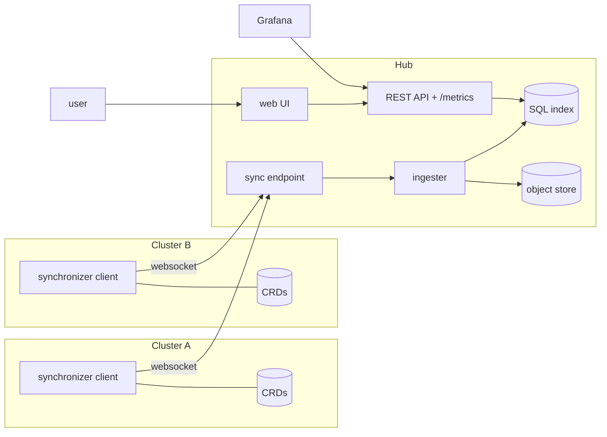

# Multi-Cluster Read-Only Data Plane (Hub)

| | |
|---|---|
| Status | Ready for implementation |
| Author | Bezalel Brandwine <bez@softwine.net> |
| Date | 2026-11-26 |
| Related work | [synchronizer](https://github.com/kubescape/synchronizer) |

## Summary

Kubescape stores everything it collects as CRDs, per cluster. Users with many
clusters have no cross-cluster view. This proposal adds a new, dedicated **hub
service**: a read-only data plane (not a control plane) fed by the existing
synchronizer.

## Mockup walkthrough

A clickable mockup (vanilla HTML/JS/CSS, mock data) covering all the flows
below: clusters, vulnerabilities, compliance, workload detail with per-kind
raw YAML, the REST API explorer, and settings.

## UX

### Starting point (today)

Users inspect data per cluster: `kubectl get vulnerabilitymanifestsummaries -A`.
Switching contexts is the only "multi-cluster" tool.

### Flow 1: Install the hub

1. User deploys the hub with a Helm chart (in any cluster) or docker-compose (on a VM).
2. Default install is zero-config: embedded SQLite + bundled MinIO.
3. For production, user points the hub at Postgres and an S3 bucket via values.
4. User sets the hub's external address (DNS/IP) via a Helm value; it can be viewed and changed later in the UI settings page.
5. User opens the hub UI; it shows an empty "Clusters" page with onboarding help.

### Flow 2: Connect a cluster

1. In the hub UI (or CLI), user clicks "Add cluster" and enters a cluster name.
2. Hub generates credentials and prints a ready-made Helm upgrade command, embedding its configured external address as the hub URL. If the address is not set yet, the UI prompts for it here and saves it.
3. User runs that command on the member cluster. It enables the existing synchronizer and points it at the hub URL.
4. Synchronizer connects using its existing auth and starts streaming objects.
5. Within ~1 minute the cluster appears "Connected" in the UI with object counts.

### Flow 3: Choose what to sync

1. By default, everything accessible locally is synced.
2. User can restrict kinds (e.g. summaries only, no full manifests) in the member cluster Helm values.
3. The hub UI shows per-cluster synced kinds, so misconfiguration is visible.

### Flow 4: Browse the multi-cluster view

1. **Clusters page**: all clusters, connection status, last-seen time, data freshness.
2. **Vulnerabilities page**: severity totals per cluster; filter by cluster, namespace, workload; drill down to a single workload's summary.
3. **Compliance page**: configuration scan scores per cluster and framework.
4. **Workload page**: one workload across clusters (same image deployed in many places); filterable by cluster, namespace, and workload. Each instance links to the full raw object (e.g. the complete VulnerabilityManifestSummary as YAML).
5. Every page shows "data as of" timestamps. Stale clusters are flagged, never hidden.

### Flow 5: Programmatic access

1. REST API mirrors the UI: `/api/v1/clusters`, `/api/v1/vulnerabilities`, etc.
2. Any synced object is fetchable in full via `/api/v1/raw/<cluster>/<kind>/<namespace>/<name>`, as JSON or YAML (`?format=yaml`).
3. The hub serves its own OpenAPI spec at `/api/v1/openapi.yaml`; the UI has a REST API page to browse endpoints, try requests, and download the spec.
4. Prometheus `/metrics` exposes per-cluster severity counts for Grafana.
5. Full raw objects are readable straight from the object store, laid out as `<cluster>/<kind>/<namespace>/<name>.json`, for users who just want files.

### Flow 6: Day-2 operations

1. Removing a cluster: one click in UI; hub revokes credentials and (optionally) purges its data.
2. Retention: hub keeps latest state only in v1; deleted objects disappear on sync.
3. A disconnected cluster keeps its last-known data, marked stale after a configurable threshold.

### Explicitly out of scope (v1)

- No remediation, no writes to member clusters.
- No RBAC per hub user (single read-only credential for UI/API).
- No history/trends; latest state only.

## Architecture

The hub speaks the synchronizer protocol on one side and serves read-only
queries on the other. Member clusters are untouched except for enabling the
existing synchronizer with a hub URL.

### Components

**Sync endpoint.** Reuses the synchronizer server-side protocol library
(websocket, existing auth, reconnect, checksums). Minor changes allowed, e.g.
a hub capability flag. One connection per cluster; target scale ~50.

**Ingester.** Consumes object events (put/delete/patch). Writes the full JSON
to the object store and an extracted summary row to the SQL index. Idempotent;
a full re-sync after reconnect converges to correct state.

**SQL index.** SQLite embedded by default, Postgres for production. Holds only
what queries need: cluster, kind, namespace, name, severity counts, scores,
timestamps. Never the full object body. Also holds hub settings, notably the
hub's external address (DNS/IP): a Helm value seeds it on startup, and a UI
edit overrides it. The "Add cluster" command is rendered from this value.

**Object store.** S3-compatible (MinIO bundled, any S3 in production). Source
of truth for raw objects. Layout: `<cluster>/<kind>/<namespace>/<name>.json`.
Users may read it directly; the API is a convenience, not a gate.

**REST API.** Read-only. Listing/filtering/aggregation from the SQL index;
single-object fetch proxied from the object store, served as JSON or YAML.
Plus Prometheus `/metrics`.

**Web UI.** Static single-page app served by the hub. Talks only to the
REST API. Pages: clusters, vulnerabilities, compliance, workload detail,
REST API explorer (OpenAPI spec + try-it), and settings.

### Data flow

1. Synchronizer watches configured kinds and streams changes to the hub.
2. Ingester verifies checksum, writes blob, upserts index row in one unit.
3. Deletes remove both the blob and the row.
4. On reconnect the existing full-sync handshake replays current state;
   objects missing from the replay are garbage-collected per cluster.

### Key decisions

- **New service, shared libs.** Own repo and deployment. One Helm chart that may ship one or several components, but imports the synchronizer protocol package.
- **Latest-state only.** No history tables in v1. Keeps schema and retention
  trivial. Trends can come later from object-store versioning.
- **Configurable scope at the edge.** The member cluster decides what to send
  (Helm values → synchronizer config). The hub accepts any known kind.
- **Single tenant.** One hub, one team, one read credential. Multi-tenancy is
  a non-goal for v1.

### Failure modes

- Hub down: clusters buffer nothing; on reconnect, full-sync restores state.
- Object store down: ingester pauses that cluster's stream (backpressure).
- Clock skew: freshness uses hub receive time, never cluster-reported time.

### Sizing (50 clusters)

Index stays small (~rows = objects, ~10⁵–10⁶). SQLite is fine to ~10 clusters;
recommend Postgres beyond that. Object store growth is bounded by latest-state
semantics.
