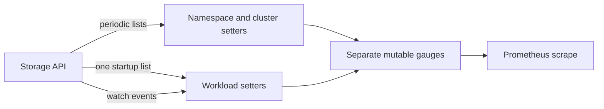
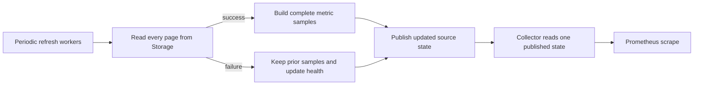

# Proposal: Prometheus exporter recovery and refresh health

- **Status:** Proposed
- **Author:** Daksh Pathak ([@dakshhhhh16](https://github.com/dakshhhhh16))
- **Date:** 30 October 2026
- **Scope:** [`prometheus-exporter`](https://github.com/kubescape/prometheus-exporter); optional configuration follow-up in `helm-charts`

## Summary

I would like to make the exporter recover its workload metrics after a missed
watch event and make it clear when the data it serves has stopped refreshing.

The proposal is to refresh each enabled summary source periodically, build its
metric samples privately, and publish them together after the complete read
succeeds. A failed refresh keeps the last successful data and updates a small
set of health metrics. A later successful refresh replaces the previous set,
including removing workload series that no longer belong in it.

[Exporter #64](https://github.com/kubescape/prometheus-exporter/pull/64), by
@ANAMASGARD, already fixes stale **namespace** series after summary deletion.
That fix is the starting point here. The remaining scope is workload recovery,
refresh health, and a consistent publication boundary for the metrics produced
from one source.

## What led me to this

While following the path from stored summaries to dashboards, I noticed that
workload metrics and aggregate metrics are maintained differently. Namespace
and cluster metrics refresh periodically, while workload metrics start with
one list and then depend on watch events.

I checked the current exporter at
[`9faa9cf4a7d0be562136cfe108f80856cbdc8361`](https://github.com/kubescape/prometheus-exporter/commit/9faa9cf4a7d0be562136cfe108f80856cbdc8361),
which includes #64:

- In [`main.go`](https://github.com/kubescape/prometheus-exporter/blob/9faa9cf4a7d0be562136cfe108f80856cbdc8361/main.go#L55),
  both workload watchers call their initial list handler before entering the
  watch retry closure. Reconnecting creates another watch, but does not relist.
- In [`api/api.go`](https://github.com/kubescape/prometheus-exporter/blob/9faa9cf4a7d0be562136cfe108f80856cbdc8361/api/api.go),
  the watch methods use `ResourceVersionFullSpec`. They do not track a last-seen
  object version or request initial events. The list methods already follow
  continuation tokens and return an error if any page fails.
- The refresh handlers log a failed read and retain existing metrics. That is
  useful behavior, but there is no exporter metric telling a dashboard when the
  last complete read succeeded.
- In [`metrics/metrics.go`](https://github.com/kubescape/prometheus-exporter/blob/9faa9cf4a7d0be562136cfe108f80856cbdc8361/metrics/metrics.go),
  namespace pruning now works, while workload metrics still depend on direct
  setters and deletion events. Cluster and namespace gauges are updated
  separately, so a concurrent scrape can see values from different refresh
  stages. This is a consistency concern; it is not a claim of an unsafe Go
  memory access.

For example, suppose the exporter has a workload's vulnerability metrics and
its watch disconnects. If that workload summary is deleted during the gap, the
next watch does not itself provide an authoritative inventory to remove the
old samples. An initial list failure has a similar problem: pre-existing
workloads need a later event or another mechanism before their metrics appear.

These observations come from source inspection. I have not measured the
frequency of these failures in production or benchmarked the proposed design.
The failure cases below are tests to establish before implementation is
considered ready.

## Goals

1. Workload metrics recover after missed events or an unsuccessful initial read,
   without requiring an exporter restart.
2. A complete successful refresh replaces that source's metric set. A failed or
   canceled read cannot publish a partial inventory or clear the last good data.
3. One scrape sees a complete published generation for each source, including
   its associated refresh health.
4. Existing metric names, types, labels, severity mappings, and workload
   enablement remain compatible.
5. Refresh work has a fixed concurrency limit, request deadlines, and shutdown
   cancellation.

## Scope

This work belongs in the exporter. It does not delete storage records, change
scan results, add per-CVE labels, or implement the alerting system discussed in
[exporter #23](https://github.com/kubescape/prometheus-exporter/issues/23).

It also does not provide a transactional snapshot of the cluster. The source
APIs are separate, and a paginated read can overlap storage changes. Here,
"complete" means that every page of a read completed successfully; "snapshot"
means the exporter publishes the resulting projection together.

## Current and proposed flow

### Sources and refresh ownership

There are four input sources:

| Source | Resource | Output |
|---|---|---|
| `configuration_summary` | `ConfigurationScanSummary` | Namespace and cluster configuration metrics |
| `vulnerability_summary` | `VulnerabilitySummary` | Namespace and cluster vulnerability metrics |
| `workload_configuration_summary` | `WorkloadConfigurationScanSummary` | Workload configuration metrics |
| `workload_vulnerability_summary` | `VulnerabilityManifestSummary` | Workload/container vulnerability metrics |

The last two run only when `ENABLE_WORKLOAD_METRICS=true`. Each enabled source
has one worker, so there are at most four active refreshes and no overlapping
attempts for the same source. A slow vulnerability read must not prevent
configuration metrics from progressing.

Each worker refreshes immediately at startup, then waits the configured interval
after its attempt finishes. This avoids accumulating timer ticks or queued work
when storage is slow. The whole attempt, including all pages, has a deadline
and inherits process cancellation.

### Workload recovery

For the first implementation, I suggest periodic lists for workload sources as
well as aggregate sources, replacing direct watch-driven metric updates. This
makes recovery independent of watch replay and keeps the state machine small.

The trade-off is extra list traffic and a change from event-driven workload
updates to refresh-interval latency. I would like agreement on that before
implementing it. If measurements show polling is too costly, watches could
later trigger coalesced refreshes, with periodic reconciliation retained as the
repair mechanism. Direct watch updates would not mutate a published snapshot.

Retain `PROMETHEUS_REFRESH_INTERVAL` and its current effective default of ten
seconds; the existing fallback log incorrectly says 120 seconds. Add a
whole-refresh timeout, provisionally `PROMETHEUS_REFRESH_TIMEOUT=30s`, and
validate both settings as positive durations. Thirty seconds is a starting
point for review and measurement, not an established limit for large clusters.

### Read completely before publishing

Reuse the pagination introduced in
[exporter #52](https://github.com/kubescape/prometheus-exporter/pull/52), including
`ResourceVersionFullSpec` on every page. Pass a `context.Context` through all
four list methods so a timeout or shutdown cancels the underlying requests.

An API error, cancellation, nil page, or repeated continuation token fails the
attempt. Discard its accumulated results and retain the last published samples.
A successful empty list is different: it removes that source's scoped series
and produces zero cluster totals where applicable.

This preserves the existing behavior on list failure and extends complete-list
replacement to workloads. It cannot identify incomplete or outdated security
results inside an otherwise successful API response.

### Publish once, collect once

Move metric projection into functions that build owned sample data from a
complete list. Keep only descriptor identifiers, label values, and numeric
values in published state; do not retain whole summary objects.

A publisher holds an immutable state with one entry per source. A worker builds
its new samples outside the publication lock. A short mutex-protected update
copies the small source map, replaces that source's entry, and publishes the
new state through an atomic pointer. Failed attempts update health while
retaining the same last-success samples and timestamp.

A custom Prometheus collector loads that pointer once per `Collect` and emits
const metrics from it. It cannot mix two generations of the same source during
that call. Other sources may have different last-success times; their health
metrics make that visible.

`Describe` returns fixed descriptors. Registration must be explicit: the new
collector replaces the current result-gauge registration rather than being
registered alongside it. Go/process collectors can remain separate.

### Preserve metric semantics

Keep the existing names, HELP strings, gauge types, label keys and normalization
of workload kind and container name. Preserve all/relevant vulnerability counts
and the negligible severity added in
[#61](https://github.com/kubescape/prometheus-exporter/pull/61).

If several returned records share a descriptor and label tuple, the current
setters make the last returned record win. Preserve that behavior within a
refresh and emit one sample for the tuple. Changing aggregation or adding UID
labels would need a separate decision.

Before a source's first successful refresh, I propose omitting its finding
metrics and exposing `initialized=0`. After a successful empty refresh, emit
known zero cluster totals and no namespace/workload samples. This deliberately
distinguishes unavailable data from an empty inventory and needs compatibility
review because today's cluster gauges can appear as zero at startup.

### Refresh health

Proposed names, all with a fixed `source` label:

| Metric | Meaning |
|---|---|
| `kubescape_exporter_source_initialized` | Gauge: 1 after the source has completed its first successful refresh; otherwise 0 |
| `kubescape_exporter_refresh_success` | Gauge: 1 if the latest completed attempt succeeded; otherwise 0, including before the first attempt completes |
| `kubescape_exporter_last_successful_refresh_timestamp_seconds` | Gauge: Unix timestamp of the last complete successful read; 0 before success |

Only enabled sources are emitted, giving two or four possible label values.
Finding samples and these health gauges come from the same loaded state. A
refresh-duration histogram can follow if useful; it is not needed for the
initial correctness change.

The timestamp describes **exporter refresh age**, not the age of a scan or its
vulnerability database. Keeping old data available during an outage is useful
only if dashboards and alerts also show that it is stale.

## Implementation outline

| Location | Work |
|---|---|
| `api/api.go`, `api/interface.go` | Context-aware readers for all four sources; preserve fullSpec pagination; expose a testable client interface |
| `metrics/metrics.go` | Extract fixed descriptors and pure projection functions; preserve existing sample semantics |
| New files in `metrics/` | Immutable source state, publisher and collector |
| A small refresh package | Worker lifecycle, deadlines, interval validation and clock injection for tests |
| `main.go` | Wire explicit collectors and process cancellation; replace workload watch mutation loops |
| Tests and README | Schema fixtures, recovery/failure cases, configuration and freshness documentation |

The implementation should reuse the existing Prometheus dependency and Go's
standard synchronization primitives. It requires no storage schema change or
new write privileges. Optional workload readers stay behind the existing
enablement setting. Chart settings can be a separate follow-up if maintainers
want interval and timeout exposed in values.

## Alternatives considered

**Keep the existing gauges and add periodic workload pruning.** This is a
reasonable smaller fix, and #64 demonstrates how to do selective pruning
without resetting retained namespace series. It would address missed deletions,
but independent gauge updates still have no shared publication boundary with
cluster totals and refresh health. I prefer snapshots if we agree that stronger
contract is worth the collector change.

**Keep watches and reconcile them with periodic lists.** This preserves lower
update latency, but needs rules for ordering a list against concurrent events,
including deletion/recreation and delayed updates. I would take on that
complexity only if the list-cost measurements justify it.

**Use informers or WatchList for all sources.** The storage API has special
fullSpec/version behavior, and its computed aggregate resources do not provide
the same change stream as stored workload summaries. Depending on one watch
protocol for all four sources would also expand storage-version compatibility
work. Periodic reads avoid that dependency for this first change.

**Fetch on each scrape.** This ties storage traffic and scrape latency to the
number and frequency of Prometheus clients. Background refresh keeps serving
local data even when storage is temporarily unavailable.

## Compatibility and rollout

Capture descriptor and sample fixtures before changing the collector. The
existing names, labels and severity mappings must match after the change,
including namespace removal and failed-read retention from #64.

The intentional changes are workload polling latency, recovery through later
complete reads, additive health metrics, and omission of uninitialized finding
metrics. These should be documented together.

Canary the new exporter under a separate scrape job and compare stable fixtures
with the current image. Include a storage restart and a workload deleted during
an outage. Compare list traffic and storage resource use before rollout.
Rollback is an image/configuration change; there is no persisted-data migration.
Removing a series from exposition does not remove its historical Prometheus
samples.

## Performance and security

Polling adds two periodically read inventories when workload metrics are
enabled. Computed aggregate resources can also do work inside storage, so client
request counts alone are not enough to judge cost.

If a source needs `P` page requests, a refresh takes `D` seconds, and the delay
between attempts is `T`, its approximate request rate is `P / (T + D)`, excluding
transport retries. Measure this with representative inventories before settling
on defaults.

Snapshot construction is proportional to returned records and emitted samples.
Peak memory includes accumulated pages, the previous snapshot, the new samples,
and any older snapshot still held by an active scrape. The worker count is
bounded; memory is not independent of cluster size. I would compare allocations,
peak heap, refresh time, scrape latency and storage CPU/bytes for 100, 1,000 and
10,000 workload fixtures with workload metrics on and off.

The exporter remains a read-only client using its existing service account and
API route. Health labels have fixed values; raw errors, workload identifiers,
credentials and finding content must not become new health labels. A timeout
must fail the refresh rather than silently truncate its inventory.

## Tests and acceptance criteria

The implementation should demonstrate:

1. A workload removed while its watch would have been disconnected disappears
   after a later complete successful refresh, without an exporter restart.
2. An initial failed read followed by success populates pre-existing workloads.
3. Page-two failure, timeout, cancellation, nil pages and repeated continuation
   tokens preserve the previous complete samples and last-success timestamp;
   refresh health reports failure.
4. A successful empty inventory removes old scoped series. The namespace
   removal and failure-retention cases from #64 remain covered.
5. Concurrent scrapes observe complete published source generations, with no
   duplicate descriptor/label tuples or mixed cluster/namespace generations
   from the same source.
6. Schema fixtures preserve all existing metrics, including relevant/all,
   negligible, label normalization and duplicate-tuple behavior.
7. A slow source does not block other sources. Workload-disabled mode performs
   no workload reads. At most four attempts are active, with one per source.
8. Shutdown cancels requests and timers. Lifecycle tests use fake clocks rather
   than depending on sleeps.

Run unit tests, race detection, vet and build checks in the exporter, followed
by an actual Storage/Prometheus integration test. The latter should cover
pagination, an outage, recovery, and the distinction between series no longer
being exposed and historical samples still being queryable. Include the
supported storage baseline as well as the current storage version.

## Delivery plan

I would start with workload-recovery fixtures and a metric-schema baseline,
then implement complete refresh and publication. The next reviewable step is
worker lifecycle and refresh health, followed by integration measurements and
documentation. The target is roughly ten working days of implementation,
subject to review feedback and agreement on the behavior below.

I would like to carry the implementation and follow-up fixes through review,
including continuing after the LFX term. The immediate decision this PR asks
for is agreement on the exporter contract and the first implementation scope.

## Questions for review

- Is periodic workload listing at the current ten-second refresh default an
  acceptable starting point, or should workloads have a separate interval?
- Is omitting finding metrics before the first successful refresh preferable
  to keeping startup zeros alongside an explicit uninitialized health signal?
- Should last-good data remain available indefinitely with freshness signals,
  as proposed, or should there be an agreed expiry policy?
- Are the proposed health names and whole-refresh timeout appropriate for this
  component? Is a representative large-cluster fixture available for testing?
- Is a shared collector/publication boundary worth doing in the first change,
  or would maintainers prefer workload reconciliation and health first?

## Related work

- [Exporter #64](https://github.com/kubescape/prometheus-exporter/pull/64):
  namespace series removal and failed-read retention. Preserve its behavior
  and extend recovery to workloads.
- [Exporter #28](https://github.com/kubescape/prometheus-exporter/pull/28):
  workload watch retries; this proposal adds an authoritative repair path.
- [Exporter #52](https://github.com/kubescape/prometheus-exporter/pull/52):
  complete pagination and fullSpec handling to reuse.
- [Kubescape #4267](https://github.com/kubescape/kubescape/pull/4267) and
  [operator #443](https://github.com/kubescape/operator/pull/443): cleanup of
  stored scan records. This proposal changes only their metric projection.
- [Design #26](https://github.com/kubescape/designs-and-proposals/pull/26):
  CLI printer contracts and streaming output, a separate component from this
  in-cluster exporter.
