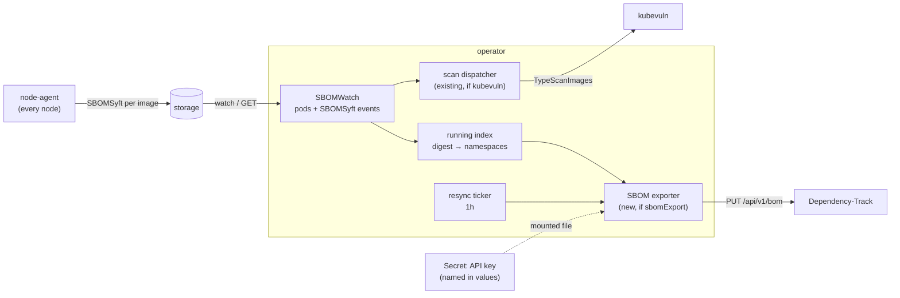

# Proposal: Export node SBOMs to Dependency-Track from the operator

- **Status:** Proposed
- **Author:** Cristian Glavan ([@clglavan](https://github.com/clglavan))
- **Date:** 2026-11-10
- **Scope:** [`operator`](https://github.com/kubescape/operator) (watch, export, Dependency-Track client);
  [`helm-charts`](https://github.com/kubescape/helm-charts) (capability, values, Secret mount, egress rule); docs
- **Related:** [kubevuln#287](https://github.com/kubescape/kubevuln/issues/287) (Dependency-Track integration request),
  [operator#484](https://github.com/kubescape/operator/issues/484) / [#485](https://github.com/kubescape/operator/pull/485)
  (pod watch without a backend), [node-agent#1084](https://github.com/kubescape/node-agent/issues/1084) /
  [#1085](https://github.com/kubescape/node-agent/pull/1085) and [storage#490](https://github.com/kubescape/storage/issues/490) /
  [#495](https://github.com/kubescape/storage/pull/495) (found while building the prototype in section 7)
- **Prototype:** [clglavan/operator `feat/sbom-export-dependency-track`](https://github.com/clglavan/operator/tree/feat/sbom-export-dependency-track),
  [clglavan/helm-charts `feat/sbom-export-dependency-track`](https://github.com/clglavan/helm-charts/tree/feat/sbom-export-dependency-track)

## 1. Summary

**In short:** Many teams track the vulnerabilities of their software in [Dependency-Track](https://dependencytrack.org).
It takes an SBOM per application, re-checks it whenever a new CVE is published, and lets people triage, suppress and
get notified. What those teams are missing is the SBOM of what actually runs in their clusters. Kubescape already makes
exactly that: with `nodeSbomGeneration`, node-agent builds an SBOM of every image that runs, from the layers on the node,
with no registry access. Today those SBOMs feed kubevuln's scans, and they leave the cluster only to ARMO's platform,
through the synchronizer. This proposal lets the operator send them to Dependency-Track, one project per image and
namespace, and keep them current as workloads change. It is off by default.

**Technically:** a new capability, `sbomExport`, turns on a second consumer of the operator's existing SBOM watch. When an
`SBOMSyft` object is ready and its image runs in a namespace that is not excluded, the operator reads the full object,
converts it to CycloneDX JSON in-process with syft's own decoder and encoder, as `syft convert` does, and uploads it
with `PUT /api/v1/bom`. A resync every hour compares what runs with what Dependency-Track holds, so an outage or a
restart loses nothing, and an unchanged image is never sent twice. The API key comes from a Secret the user names in
the chart values. A working prototype is linked above and described in section 7.

## 2. Motivation

### The problem

Getting Kubescape's SBOMs into Dependency-Track today means writing your own exporter: list the running pods, match each
container's image digest to its `SBOMSyft`, GET the full object (LIST returns metadata only), convert the syft document
to CycloneDX, and drive Dependency-Track's project API. We wrote one (section 7). It works, but it is glue around data
that Kubescape owns: every team that wants this rebuilds it, and it breaks whenever storage's API changes. The request
is not new: [kubevuln#287](https://github.com/kubescape/kubevuln/issues/287) asked for a Dependency-Track integration in
April 2025 and was closed without a change.

The tools that exist outside Kubescape, such as [sbom-operator](https://github.com/ckotzbauer/sbom-operator), pull
every running image from its registry and run syft on it. That needs a pull secret for each registry and downloads
images the nodes already have. Kubescape's node SBOMs avoid both.

### Why the operator

| Component | Fit |
|---|---|
| node-agent | Makes the SBOMs, but one per image for the whole cluster, so it does not see every namespace the image runs in. Every node would hold the API key, and nothing would retry an upload made while Dependency-Track was down. |
| storage | Holds the SBOMs, but it is the aggregated API server. Outbound HTTP calls in its write path would put an external service on the path of every node-agent write. |
| kubevuln | Its `Platform` port (`SubmitCVE`) carries vulnerability results and needs grype running in the cluster, which is the work Dependency-Track does itself. |
| synchronizer | Already sends SBOMs out (`syncSBOM`), but it copies storage objects to ARMO's backend over that backend's own protocol, and the chart deploys it only when a backend (`server`) is configured. Dependency-Track needs a conversion and its own project model, not an object copy. |
| **operator** | **Already watches `SBOMSyft` objects and running pods (`watcher/sbomwatcher.go`), already holds the RBAC for both, runs one replica, and already mounts extra CA certificates (`global.extraCaCertificates`).** |

## 3. Words used in this proposal

| Term | Meaning |
|---|---|
| **SBOM** | Software bill of materials: the packages, versions and licenses found in an image. |
| **`SBOMSyft`** | The storage object node-agent writes for each image, in Kubescape's namespace. `.spec.syft` holds a syft JSON document. |
| **CycloneDX** | The SBOM format Dependency-Track ingests. |
| **Project / version** | Dependency-Track's unit: one SBOM per `name:version`. A project can have a parent. |
| **Collection project** | A project with no SBOM of its own whose metrics add up its children (Dependency-Track 4.13+). |
| **`isLatest`** | Marks one version of a project as the current one (Dependency-Track 4.12+). |

## 4. Current state

Facts this design relies on, checked on `main` of each repository on 2026-11-10:

- **node-agent** writes one `SBOMSyft` per image digest in Kubescape's namespace, with annotations
  `kubescape.io/image-id`, `kubescape.io/image-tag` and `kubescape.io/status`. A finished SBOM has status `ready`
  (`helpersv1.Learning` in k8s-interface).
- **storage** returns metadata only on LIST; a GET by name returns `.spec.syft`.
- **Who reads `SBOMSyft` today:** kubevuln, for vulnerability scans (via the operator, below); the synchronizer, which
  copies them to ARMO's backend when a backend is configured and `capabilities.syncSBOM` is `enable`; and read-only
  tools: storage's MCP endpoint (`list_sboms`, `list_sbom_packages`) and the CLI's `kubescape mcpserver`. With
  `nodeSbomGeneration` off, kubevuln makes the SBOMs itself by pulling the image (`CreateSBOM` in
  `adapters/v1/syft.go`).
- **operator** starts `SBOMWatch` only when kubevuln is enabled and `nodeSbomGeneration` is on
  (`mainhandler/handlerequests.go`, `HandleWatchers`). `SBOMWatch` lists and watches running pods and fills
  `ImageToContainerData`, which keeps **one** workload per image hash (the last pod seen). It then lists and watches
  `SBOMSyft` objects through a `CooldownQueue` and sends kubevuln a `TypeScanImages` command per ready SBOM. Since
  [#485](https://github.com/kubescape/operator/pull/485) the pod watch also runs without a backend.
- The operator's ClusterRole already allows `get`/`list`/`watch` on pods cluster-wide and on `sbomsyfts`.
- **kubevuln** turns storage's `v1beta1.SyftDocument` into a syft `*sbom.SBOM` with a JSON round trip into a copy of
  syft v0.98's model conversion (`domainToSyft` in `adapters/v1/domain_to_syft.go`); syft's own `syftjson` decoder
  does the same today. kubevuln and node-agent v0.3.310 build against syft v1.55.0 (the `kubescape/syft v1.55.0-ks.3`
  fork). The operator has syft only as an indirect dependency (v1.42.3), builds against storage v0.0.301, and
  configures its storage client for protobuf (`main.go`).
- **helm-charts** renders the operator when `capabilities.operator` is `enable`, and node-agent only when one of its
  runtime capabilities is on (`templates/_common.tpl`); `nodeSbomGeneration` is not one of them. The operator's
  NetworkPolicy adds egress rules only with `global.networkPolicy.createEgressRules`.

## 5. Goals and non-goals

### Goals

- With one capability and one Secret, the SBOM of every running image reaches Dependency-Track, grouped by cluster and
  namespace.
- No registry access and no second SBOM generation: the export uses node-agent's SBOMs as they are.
- Nothing is lost when Dependency-Track is unreachable or the operator restarts, and nothing unchanged is sent again.
- Works without kubevuln: exporting does not require vulnerability scanning in the cluster.
- Works with the Dependency-Track versions in use: 4.13+ and 5.x.

### Non-goals

- Sending vulnerability results or VEX to Dependency-Track. Dependency-Track computes its own; sending kubevuln's
  results is a possible follow-up.
- Deleting Dependency-Track projects. Projects of images that stopped running stay; see open question 5.
- Host SBOMs. The first version exports container images only.
- Other targets (GUAC, OCI registries, git). The export goes through a small interface so they can be added later
  without touching the watchers.

## 6. Proposed design

### 6.1 Big picture



`HandleWatchers` starts `SBOMWatch` when kubevuln **or** `sbomExport` is enabled. `SBOMWatch` passes its pod and SBOM
events to the exporter, and with kubevuln off it sends no scan commands and skips resolving workloads. With
`sbomExport` off nothing changes.

### 6.2 Which namespaces an image runs in

`ImageToContainerData` keeps one workload per image, which is enough to scan an image once but not to file it under
every namespace that runs it. The exporter keeps its own index, `digest → {namespace → last seen}`, fed by the same pod
events, including deletes. Namespaces in the chart's `excludeNamespaces` are skipped, as node-agent skips them.

A namespace stays in the index for one resync interval after its last pod with that image ends. Without that, a short
Job would end before node-agent's SBOM is ready, and its image would never be exported. The index lives in memory, so
a Job that ended just before an operator restart is not exported.

### 6.3 One export, step by step

1. **Trigger.** An `SBOMSyft` becomes `ready`; a pod starts with an image whose SBOM is already ready; or the resync
   ticker fires. Events go through a `CooldownQueue` keyed by digest, as the scan path does.
2. **Resolve.** Look up the namespaces that run the digest. None: stop.
3. **Compare.** For each namespace, look up the image's project (6.4). If its `lastBomImport` is newer than the
   `SBOMSyft`'s `creationTimestamp`, only make sure the running tag is the one marked `isLatest`, then stop.
4. **Convert, once per digest.** GET the full `SBOMSyft`, convert `.spec.syft` to a syft `sbom.SBOM`, encode CycloneDX
   JSON. An image that runs in three namespaces is converted once and uploaded three times.
5. **Upload.** `PUT /api/v1/bom` with `projectName`, `projectVersion`, `autoCreate: true`, `isLatest: true` and the
   namespace's `parentUUID`.
6. **Retry.** A failed image is retried with exponential backoff, from 5 seconds up to 5 minutes, five times. The next
   resync picks up whatever is still missing, so the exporter keeps no state of its own besides the in-memory index.

The resync rebuilds the index from one paged list of running pods and runs step 3 for every running image. In steady
state it sends nothing: in the prototype, an hourly run over 25 images made only lookups and took 7 seconds.

### 6.4 Where projects go in Dependency-Track

The default layout is a tree, so each team finds its namespace and the cluster shows totals:

```text
<cluster> : current                              collection: adds up its namespaces
└── <cluster>/<namespace> : current              collection: adds up the latest version of each image
    └── <cluster>/<namespace>/<repository> : <tag>
```

`<cluster>` defaults to the chart's `clusterName`. The two collection levels use the fixed version `current`, because
Dependency-Track 5.x rejects a project without a version. An image referenced only by digest gets the first 12
characters of the digest as its version. The exporter creates the collections with `PUT /api/v1/project` and sets their
`collectionLogic` (`AGGREGATE_DIRECT_CHILDREN` and `AGGREGATE_LATEST_VERSION_CHILDREN`).

The tree needs Dependency-Track 4.13+ (collections), 4.12+ (`isLatest`) and 4.8+ (`parentUUID` on upload). For older
versions, or for users who prefer tags to hierarchy, a `flat` layout could upload `<repository>:<tag>` with the tags
`cluster:<cluster>` and `namespace:<namespace>`, similar to sbom-operator's `tag-namespace` mode. The prototype
implements the tree only (open question 2).

### 6.5 Converting to CycloneDX

The exporter GETs the `SBOMSyft` as JSON, asking for it explicitly because the operator's storage client asks for
protobuf, and hands `.spec.syft` to syft's `syftjson` decoder and `cyclonedxjson` encoder (CycloneDX 1.6). That is what
`syft convert` does: on a real node-agent SBOM the result has the same components and dependencies. Reading raw JSON
also keeps the fields that the operator's older storage types (v0.0.301) would drop, and leaves kubevuln's code where
it is.

The operator pins the same syft fork as node-agent and kubevuln, because it decodes what node-agent's syft wrote, plus
node-agent's two containerd pins: syft v1.55.0 declares a containerd/v2 whose API module no longer compiles with the
containerd v1.7 that inspektor-gadget imports. The cost is size. The syft-json decoder imports the package types of
every ecosystem, and the operator binary grows from 158.0 MB to 198.5 MB (linux/arm64, open question 1).

### 6.6 Configuration

```yaml
capabilities:
  nodeSbomGeneration: enable
  sbomExport: disable                 # new; default disable

sbomExport:
  resyncInterval: 1h
  dependencyTrack:
    url: ""                           # API base URL, e.g. https://dtrack.example.com
    apiKeySecret:
      name: ""                        # existing Secret in Kubescape's namespace; the chart never creates it
      key: apiKey
    rootProject: ""                   # default: clusterName
```

The chart passes these to the operator's `config.json` and mounts the key as a directory at `/etc/sbom-export`, not as
an environment variable or a `subPath`. The operator reads the file for each request, so a rotated Secret takes effect
without a restart. The render fails without a URL or a Secret name. Without `nodeSbomGeneration` or the operator,
`ks-capabilities` reports `sbomExport` as disabled in `effectiveCapabilities`, with a warning, as it does for
`httpDetection`. With `global.networkPolicy.createEgressRules`, the operator can already reach port 443; a
Dependency-Track on another port gets its own egress rule. A private CA goes through the existing
`global.extraCaCertificates`, which the operator already mounts.

The Dependency-Track team behind the key needs `BOM_UPLOAD`, `PROJECT_CREATION_UPLOAD` and `VIEW_PORTFOLIO`, plus
`PORTFOLIO_MANAGEMENT` on 4.x, or the narrower `PORTFOLIO_MANAGEMENT_CREATE` and `PORTFOLIO_MANAGEMENT_UPDATE` on 5.x,
to create the collections and set their collection logic.

### 6.7 Limits and failure handling

- One upload at a time by default, with a per-request timeout.
- `SBOMSyft` objects with status `too-large` or `incomplete` are skipped, as the scan path skips them.
- A 401 or 403 from Dependency-Track is logged once per resync with the permission list above, not once per image.
- One image failing never stops the others. Each resync logs one summary line: sent, unchanged, skipped, failed.

## 7. Evidence: two prototypes

### 7.1 A CronJob on GKE

We run this today as a CronJob outside Kubescape on a GKE cluster: GKE 1.35, containerd 2.2.7, four nodes in two
pools. The chart is kubescape-operator 1.42.0 with SBOM generation only. The exporter is a Python script, standard library
only, that runs `syft convert` and uploads to Dependency-Track 5.2.1. It runs every hour.

- 25 running images in 11 namespaces, 27 `SBOMSyft` objects.
- Once every image has been uploaded, an hourly run takes about 7 seconds: 24 images unchanged, nothing sent.
- One image is skipped on every run: node-agent's own image, for which no `SBOMSyft` exists.

Building it turned up three Kubescape issues, all fixed upstream now:

- node-agent ignored overlay whiteouts, so SBOMs listed packages that a later layer deleted (144 extra npm packages in
  one image): [node-agent#1084](https://github.com/kubescape/node-agent/issues/1084), fixed by
  [#1085](https://github.com/kubescape/node-agent/pull/1085).
- storage's cleanup deleted the SBOMs of running images whose namespace held no storage objects, which with SBOM
  generation alone is every application namespace: [storage#490](https://github.com/kubescape/storage/issues/490),
  fixed by [#495](https://github.com/kubescape/storage/pull/495). Until a chart ships that fix, the prototype also
  turns on `runtimeObservability`.
- The chart deploys node-agent only with a runtime capability on, so the prototype also turns on `runtimeDetection`,
  with no rules installed (open question 4).

### 7.2 This design, in the operator

The [operator branch](https://github.com/clglavan/operator/tree/feat/sbom-export-dependency-track) adds the
`sbomexport` package, the `SBOMWatch` wiring, the config and a feature doc; the
[chart branch](https://github.com/clglavan/helm-charts/tree/feat/sbom-export-dependency-track) adds the capability,
the values, the Secret mount and the egress rule.

- **Unit tests** cover the running index (pod deletes, the grace period, a full replace), project names and versions,
  the "send only when newer" rule, the Dependency-Track client against a fake server, the JSON read from a protobuf
  storage client, and the watcher fan-out with kubevuln on and off. Breaking any of six key behaviors on purpose makes
  its test fail.
- **Conversion:** on the SBOM node-agent v0.3.310 stored for `curlimages/curl:8.11.1`, the exporter's CycloneDX has the
  same 38 components and the same dependencies as `syft convert -o cyclonedx-json@1.6`.
- The operator's test suite passes on Linux, the changed packages also under `-race`, and golangci-lint reports nothing
  in the new code. The chart's 340 unit tests pass, 9 of them new.

On kind (Kubernetes 1.35, containerd 2.2.0), with Dependency-Track 4.14.6 and the chart from the branch (SBOM
generation only, the operator and `sbomExport` on, a 2-minute resync):

- The first resync sent all four running images within a second, including Dependency-Track's own image (365
  components). Each image project sits under its namespace collection and each namespace under the cluster root, with
  the collection logic set, and Dependency-Track 4.14 accepted the CycloneDX 1.6 BOMs.
- The same nginx image in two namespaces became two projects from one conversion.
- A Job that ran for 8 seconds was exported while it ran, through its pod event. Its SBOM existed from an earlier run;
  an SBOM that is ready only after the Job ended is covered by a unit test.
- Later resyncs reported every image as unchanged and sent nothing.
- With Dependency-Track unreachable (its Service pointed at no pod), exports failed and were retried. A new image
  (memcached) whose SBOM became ready during the outage was sent 5 seconds after Dependency-Track came back, by the
  retry, before the next resync.

Not tested yet: Dependency-Track 5.x with the Go exporter (the CronJob in 7.1 makes the same API calls against 5.2.1),
and a large cluster.

### What the prototypes changed in this design

- Dependency-Track 5.x refuses projects without a version, hence `current` on the collection levels.
- Comparing `lastBomImport` with the SBOM's creation time keeps steady-state runs free of uploads.
- Converting once per digest matters: shared base images run in many namespaces.
- Short-lived pods end before their SBOM is ready, hence the grace period in 6.2.
- The operator's storage client asks for protobuf, so the exporter asks for the SBOM document as JSON (found on kind).
- Dependency-Track answers a missing project with a plain-text 404, not JSON.

## 8. Security considerations

- **The API key** stays in a Secret the user creates. The operator gets it as a mounted file; it needs no RBAC on
  Secrets and never logs the key.
- **What leaves the cluster:** package names, versions, licenses and the paths where syft found them, plus namespace
  names and image references. The feature is off by default, and its documentation lists what is sent.
- **Where it goes** is set by the cluster admin in the chart values. There is no CRD, so tenants cannot point the
  operator at another URL.
- **TLS** is always verified; a private CA goes through `global.extraCaCertificates`.

## 9. Rollout

1. operator: the `sbomexport` package (index, exporter, Dependency-Track client, conversion), its config, and
   `SBOMWatch` starting when `sbomExport` is on.
2. helm-charts: the `sbomExport` capability and values, the Secret mount, the egress rule.
3. docs: a page on setting up the Dependency-Track team and key.

With `sbomExport` off, the operator behaves exactly as today.

## 10. Test plan

- **Unit:** project names and versions for both layouts, including digest-only images; the "send only when newer" rule;
  the index with pod deletes and the grace period; fan-out with kubevuln on and off.
- **Conversion:** a fixed `SBOMSyft` converts to the same CycloneDX components that `syft convert` produces from the
  same document.
- **End to end on kind:** a Dependency-Track container (4.14 and 5.x), the same image in two namespaces, and a check
  that both projects exist under the right parents, with one conversion. The prototype ran this by hand against 4.14.6
  (7.2); a CI job would run it against both.
- **Failures:** Dependency-Track stopped during a run, then started: the next resync uploads the rest. A key without
  `PORTFOLIO_MANAGEMENT`: one clear log line, no crash loop.

## 11. Alternatives considered

- **Keep it outside Kubescape** (our CronJob): it works, but every user rebuilds it, and it depends on storage details
  such as LIST returning metadata only.
- **node-agent, storage, kubevuln or the synchronizer:** see the table in section 2.
- **A new component**, like prometheus-exporter: cleaner separation, and it keeps syft out of the operator binary,
  but a new image and release to maintain, and it would duplicate the watchers the operator already has. The
  `sbomexport` package does not depend on the operator's other code, so moving it into its own binary is
  straightforward if maintainers prefer that.
- **sbom-operator:** uploads to Dependency-Track already, but builds its own SBOMs by pulling every image from its
  registry.

## 12. Open questions

1. The export adds 40.5 MB to the operator binary (158.0 to 198.5 MB). Is that acceptable, or should it ship as a
   separate image (section 11)?
2. Which layout should be the default: `tree` (needs Dependency-Track 4.13+) or `flat`?
3. Should `sbomExport` turn on the operator by itself, or fail the chart render unless `capabilities.operator` is
   `enable`?
4. Should the chart deploy node-agent when `nodeSbomGeneration` is the only capability on? Today it takes a runtime
   capability, and the prototype runs `runtimeDetection` with no rules for that reason alone.
5. For images that stopped running: leave the projects as they are (the prototype), or mark them inactive, as
   sbom-operator's `dtrack-manage-project-active-status` does?

## 13. References

- [Dependency-Track](https://dependencytrack.org) and its [BOM upload API](https://docs.dependencytrack.org/usage/cicd/)
- Dependency-Track releases: [4.8.0](https://github.com/DependencyTrack/dependency-track/releases/tag/4.8.0) (parent on
  upload), [4.12.0](https://github.com/DependencyTrack/dependency-track/releases/tag/4.12.0) (`isLatest`),
  [4.13.0](https://github.com/DependencyTrack/dependency-track/releases/tag/4.13.0) (collection projects)
- [kubevuln#287](https://github.com/kubescape/kubevuln/issues/287): Decoupling image tracking, SBOMs and vulnerabilities
- [operator `watcher/sbomwatcher.go`](https://github.com/kubescape/operator/blob/main/watcher/sbomwatcher.go),
  [`mainhandler/handlerequests.go`](https://github.com/kubescape/operator/blob/main/mainhandler/handlerequests.go)
- [kubevuln `adapters/v1/domain_to_syft.go`](https://github.com/kubescape/kubevuln/blob/main/adapters/v1/domain_to_syft.go)
- [sbom-operator](https://github.com/ckotzbauer/sbom-operator)
