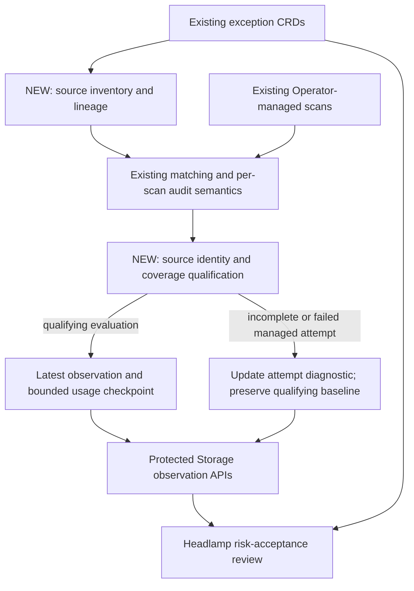
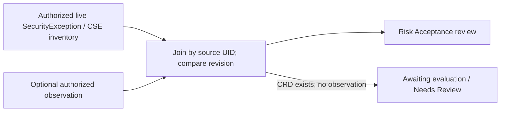

# SecurityException Lifecycle Governance and Continuous Risk-Acceptance Review

- **Status:** Proposed; no feature implementation accompanies this document.
- **Date:** 2026-10-27
- **Scope:** One Operator-managed cluster, Storage enabled, CRD-backed posture exceptions, and the local in-cluster persistence path.
- **Related:** [SecurityException work #1982](https://github.com/kubescape/kubescape/issues/1982), [exception audit #3095](https://github.com/kubescape/kubescape/pull/3095), [Storage MCP design](storage-mcp-endpoint.md), [output contracts](streaming-printer-api-and-output-contracts.md).
- **Research baseline:** Default branches inspected on the date above; source links are pinned. Merged design documents establish precedent, not implementation delivery.

## Summary

Persist durable, coverage-qualified observations about existing posture exceptions through Kubescape Storage, and review them in Headlamp's existing Exceptions area. Each observation identifies the evaluated source revision and scope, current usage, the latest evaluation attempt, and a bounded checkpoint of the last observed match.

The design distinguishes three concepts:

- **Exception definition:** the authored risk acceptance in a live `SecurityException` or `ClusterSecurityException` CRD. These declarations remain the authoritative configuration inventory.
- **Observation:** supplementary scanner state describing what a qualifying evaluation established. It is neither an acceptance decision nor an append-only audit log.
- **Review signal:** Headlamp's interpretation of observation facts and current configuration, such as In Use, Needs Review, or Expiring.

This project builds on previous LFX and existing Kubescape work; it does not recreate it. Existing matching, expiration, automatic rescans, Events, Headlamp CRUD/guided creation, CLI auditing, and scan-result persistence remain unchanged. New work comprises source lineage, coverage qualification, durable observations/checkpoints, protected observation APIs, and a minimal review view.

Recommend dedicated aggregated resources provisionally named `PostureExceptionObservation` and `ClusterPostureExceptionObservation`. Their naming distinguishes their replaceable lifecycle from the existing per-scan CLI `ExceptionAudit`. Namespace-only readers cannot access privileged cluster observations. The MVP excludes history, stale-risk heuristics, CI enforcement, vulnerability/VEX governance, and automatic changes to exceptions; matched resource samples are optional.

## Motivation and Problem Statement

An exception can remain in Git long after the workload, control, or original operational need changes. Its reason and expiry describe what was accepted; a finding or Event can show a recent match. Neither establishes whether an unchanged exception was successfully evaluated against its applicable scope or when a match was last observed.

Kubescape already audits exceptions within an individual scan. Operator users need durable evidence to answer: **which configured risk acceptances have trustworthy recent usage evidence, and which need human review?** A zero from a targeted scan or skipped control is insufficient evidence for removal.

The inspected HTTP scanner does not enable exception auditing, its persisted posture report omits that audit, and Storage's scan APIs have no per-exception observation/checkpoint contract. The remaining gap is durable review information. V1 targets the existing local persistence path: cloud-account deployments that skip that path are unsupported and must show governance unavailable, rather than imply equivalent cloud governance. [HTTP scan][ks-http] [defaults][ks-defaults] [Storage types][st-types]

## Existing Architecture

### Existing exception functionality

| Concern | Verified implementation and implications |
|---|---|
| Definition and ownership | Helm installs namespaced `SecurityException` and cluster-scoped `ClusterSecurityException`, both **`kubescape.io/v1beta1`**; kubevuln owns their Go types. They carry posture/vulnerability entries, selectors, author/reason, and expiry. The chart exposes an empty status schema/subresource, but scanners do not write governance status. [CRDs][hc-crd] [cluster CRD][hc-cse] [types][kv-types] |
| Policy representation | `armotypes.PostureExceptionPolicy` belongs to **armosec/armoapi-go**. Conversion maps `ignore` to `Disable` and `alert_only` to `AlertOnly`. An alert-only match records usage without necessarily suppressing a failure. [policy type][armo-policy] [conversion][ks-getter] |
| Loading and precedence | `getExceptionsGetterForTarget` selects file (`--exceptions`), cloud, or released/cached primary exceptions and merges CRDs only for live-cluster scans. `CRDExceptionsGetter.GetExceptions` paginates both kinds; `MergedExceptionsGetter` gives primary file/cloud scopes precedence on overlap. [selection][ks-init] [getter][ks-getter] [merge][ks-merge] |
| Conversion and matching | `convertCRDObjectToPosturePolicies` creates policies per posture entry with CRD reference attributes; `buildResourceDesignators` preserves namespace scope. `Result.SetExceptions` records policies on rule results. The shared processor handles selectors; `exceptions.FilterExceptionsByFrameworks` filters policy tuples for framework-aware status views. [conversion][ks-getter] [resource results][opa-results] [processor][opa-exceptions] [rule status][opa-rules] |
| Expiry and Events | `OPAProcessor.updateResults` preserves loaded policies, filters expired policies, applies exceptions, and optionally builds the audit. Expired declarations remain configured. `emitExceptionMatchEvents` emits Normal `ExceptionMatched` Events on CRD references, with scanned-resource fallback for file/cloud exceptions. [aggregation][ks-update] [Events][ks-events] |
| CLI audit | `ScanInfo.AuditExceptions` / `--audit-exceptions` enables `buildExceptionAudit`. Items contain status, control IDs, invalid controls, counts, and matched resource/control/rule references. Precedence is **expired → invalid-control → matched → unused**. Counts are rule-policy occurrences plus manual-control applications, not distinct workloads. [contract][ks-contract] [audit][ks-audit] [flag][ks-flag] |
| Operator | `SecurityExceptionWatchHandler` already watches both kinds, coalesces/throttles change rescans, and periodically sweeps expiry. Startup requires riskAcceptance and Kubescape enabled; rescans use installed default frameworks. [watcher][op-watch] [startup][op-start] |

The public CLI audit cannot simply be copied into durable state. Its `exceptionAuditKey` uses GUID or name, while converted CRD names are `name/controlID`; namespaces and framework entries can collide. CRD attributes preserve identity for Events, but `ExceptionAuditItem` does not expose a stable source reference. Moreover, audit input is already converted and merged: conversion failures, zero-match namespace selectors, primary precedence, and secondary retrieval failures can remove policies. Absence from that list does not establish non-use. [audit][ks-audit] [getter][ks-getter] [merge][ks-merge] [zero-selector test][ks-zero-test]

`invalidExceptionControls` tests regex selectors against the scan's `AllPolicies.Controls`; absent/empty catalogs yield no invalid IDs. Unselected controls must not become globally invalid. Manual controls also have a separate application path: it rejects resource-scoped designators, whereas CRD conversion supplies namespace/kind scopes. Existing generic manual-audit support does not imply every CRD can match a manual control. Both boundaries must remain unchanged. [audit][ks-audit] [manual application][ks-update]

### Execution and persistence boundary

The Operator's `ActionHandler.kubescapeScan` sends a `PostScanRequest` to the scanner service and polls status; it does not persist posture results itself. In `httphandler/handlerequests/v1.scan`, `result.ScanData` contains the session's policies, results, coverage, and any generated audit. The handler persists `result.GetResults()` through `APIServerStore.StorePostureReportResults` when local Storage persistence applies. [Operator request][op-request] [request defaults][op-request-helper] [HTTP scan][ks-http]

`ToScanInfo` and `defaultScanInfo` do not currently set `AuditExceptions`; `PostScanRequest` has no audit flag. Enabling the boolean alone would not preserve the data: `GetResults()` finalizes a `PostureReport`, whereas `ExceptionAudit` lives on the session/output envelope. The writer saves workload controls and applied exception names, not complete per-source usage. [conversion][ks-toscan] [request type][opa-request] [results][ks-results] [writer][ks-store]

### Storage patterns to reuse

Storage serves aggregated APIs under `spdx.softwarecomposition.kubescape.io/v1beta1`. `WorkloadConfigurationScan` and its summary are namespaced current-state artifacts. Ordinary results use the resource namespace; cluster/related-object results use the installation namespace. Stable keys, report timestamps, and same-report merging support updates rather than per-scan history. [writer][ks-store] [types][st-types]

`ConfigurationScanSummary` is **cluster-scoped**, despite its namespace-named objects. `ConfigurationScanSummaryStorage.Get/GetList` computes it from workload summaries and rejects writes. An unmatched exception has no workload summary from which to reconstruct its evaluation. Extending this resource would require additional ownership and authorization design. [computed storage][st-computed] [scope][st-summary-strategy] [tests][st-computed-tests]

Reuse Storage's ordinary result backend, serialization, REST registration, and lifecycle machinery. LIST normally returns metadata; consumers needing observation facts must request full objects and follow continuation tokens. Cleanup is resource-specific: workload-identity cleanup cannot govern unmatched exceptions. Use source identity and successful inventory evidence instead. [registration][st-server] [backend][st-backend] [cleanup][st-cleanup] [existing sweep][ks-sweep]

## Relationship to Existing Work

Existing foundations are **SecurityException/ClusterSecurityException, CRD conversion, matching, expiration, Operator watching/automatic rescans, ExceptionMatched Events, Headlamp CRUD/guided creation, CLI `--audit-exceptions`, and in-cluster result persistence**. None is a new deliverable.

| Previous work | Relationship and delivery evidence |
|---|---|
| **LFX 2023 Term 2: configuration results as CRs** | The [program entry][lfx-2023] and [#1225](https://github.com/kubescape/kubescape/issues/1225) cover local results and change-triggered scans. [storage#39](https://github.com/kubescape/storage/pull/39), merged August 30, 2023, introduced computed scoped summaries. Today's writer, Operator continuous scanning, and Storage APIs are architectural descendants to reuse, without attributing every current implementation to that mentorship. |
| **LFX 2026 Term 2: GitOps-native exceptions** | The [program][lfx-t2] includes conversion/selectors, precedence, expiry, Events, rescans, Helm validation, and Headlamp support. Merged work includes scanner [#2366](https://github.com/kubescape/kubescape/pull/2366), [#2480](https://github.com/kubescape/kubescape/pull/2480), [#2317](https://github.com/kubescape/kubescape/pull/2317), Events [#2291](https://github.com/kubescape/kubescape/pull/2291), Operator [#392](https://github.com/kubescape/operator/pull/392), Headlamp [#86](https://github.com/kubescape/headlamp-plugin/pull/86), and Helm [#817](https://github.com/kubescape/helm-charts/pull/817), [#859](https://github.com/kubescape/helm-charts/pull/859), [#875](https://github.com/kubescape/helm-charts/pull/875). Some foundations predate the term. |
| **Delivery qualifications** | The tracking issue retains older wording/checklists; code installs `v1beta1`, not its stated `v1`. Headlamp provides CRUD/guided forms and excluded-finding rendering, including a temporary client-side approximation that skips object selectors. No dedicated matched-resource history or `ExceptionMatched` event renderer was found in the inspected exception detail. Promised outcomes are not automatically delivered outcomes, and that overlay is not governance evidence. [list][hl-list] [detail][hl-detail] [overlay][hl-overlay] |
| **Existing CLI audit** | [#3095](https://github.com/kubescape/kubescape/pull/3095) merged August 15, 2026; [#3371](https://github.com/kubescape/kubescape/pull/3371) subsequently fixed manual-control counting. Classifications, match counts, and resource references already exist. |
| **2026 Term 3: External VEX** | [Program][lfx-t3] and [design](vex-ingestion.md): vendor vulnerability statements and suppression provenance. This project excludes vulnerability/VEX governance and adjacent kubevuln metrics, despite sharing exception CRD identity. |
| **2026 Term 3: Evidence of Finding** | [Design](evidence-of-finding.md): path/value/source-location evidence and redaction. Governance links to existing result details without implementing its renderer or storing manifests/values. |
| **2026 Term 3: Fleet; Agent Sandbox/gVisor** | [Program][lfx-t3]: multi-context aggregation/drift and agent posture/admission/runtime visibility. This is single-cluster exception review, with no fleet aggregator, detection controls, or runtime sensor. |

The new deliverables are **source identity/lineage, coverage-qualified observations, durable latest observations, a bounded last-observed-match checkpoint, protected observation APIs, and Headlamp risk-acceptance review**.

## Goals

- Preserve trustworthy usage evidence across scanner and UI restarts, tied to source revision and evaluation scope.
- Distinguish observed non-use from incomplete evaluation, changed configuration, and old evidence.
- Provide last qualifying evaluation, last observed match, current counts, and authorized review links.
- Enforce namespace isolation at the API boundary and keep retained state bounded.
- Deliver an additive MVP for one contributor over approximately 10–12 weeks.

## Non-Goals

- New exception formats/CRDs, matching rules, compliance scores, watchers, or automatic rescans.
- Automatic exception deletion, renewal, editing, or risk approval; replacing Git history or Kubernetes audit logs.
- Recreating Headlamp CRUD/guided creation, a new database, or lifetime “never used” claims.
- Historical timelines, staleness heuristics, approval workflows, ticketing, Prometheus metrics, CI enforcement, vulnerability/VEX governance, fleet aggregation, or namespace projections of CSE observations.

## Proposed Design

### Architecture and Ownership



The scanner owns evaluation and publication; Storage owns the protected API and persistence; the Operator retains trigger ownership. Headlamp joins declarations with observations and derives presentation without performing exception matching.

Enable the producer through opt-in installation configuration requiring riskAcceptance, posture scanning, and local Storage persistence. The exact chart setting is not fixed here. Reuse exception-change/expiry triggers and periodic configuration scans; continuous single-resource scans do not establish a lifecycle baseline. Quiet clusters need a periodic full-scan cadence consistent with the chosen freshness policy. An installation without that cadence must show awaiting/overdue evidence, not a continuously maintained verdict.

### Source Identity

Capture a typed inventory **before** conversion losses, primary precedence, and expiration filtering. It includes source kind/namespace/name/UID, generation/resourceVersion, a canonical spec digest, per-entry identity, and load/conversion/selector-resolution outcomes.

Correlation must use UID and revision-aware entry identity, not display names or parsed `name/controlID` strings. An internal key such as `(sourceUID, specDigest, entryIndex)` can distinguish same-named sources across namespaces and repeated controls across frameworks; the exact representation remains an implementation choice. Carry lineage through converted policy copies and merge decisions, then derive document totals from attributed entries.

Use the UID to match a live declaration to its observation; use revision/digest information to decide whether that observation describes the current spec. Recreating a name with a new UID never inherits usage. Metadata-only changes need not reset the checkpoint if the spec digest remains unchanged. Including the whole spec in that digest is a conservative initial choice: changes to risk rationale also begin a new observation period, even if matching fields remain similar.

### Coverage and Qualifying Evaluations

An evaluation qualifies **for a particular source** only when:

1. It is a completed installation-managed configuration scan with identified policy profile; ad hoc targeted/resource/CI scans cannot replace the baseline.
2. Source inventory and relevant selector resolution completed, including pagination, and captured UID/revision identity is known.
3. Applicable posture entries were evaluated or conclusively classified against a complete trusted control catalog. Unselected frameworks/controls are Not Evaluated, not invalid or unused.
4. Required resources were collected completely enough for the source's entire applicable scope. Reuse `ScanCoverage`, `ListedGVRs`, failed/partial pulls, timed-out/not-evaluated controls, and policy degradations, supplemented with CRD outcomes that are currently logged/skipped. A coverage percentage alone is insufficient. [coverage][ks-coverage]
5. Source revision remained unchanged during evaluation, and namespace-contained reporting is supported for its dependencies/results.

Completeness is per source, with an explicit profile/applicability fingerprint. Chart defaults exclude system namespaces; they do not prove cluster completeness. A namespaced source may qualify when its entire applicable namespace/control scope is covered despite exclusions elsewhere. A CSE needs evidence covering all namespaces and cluster resources it could affect; unrestricted CSEs under exclusions remain incomplete. Reject uncertain selector or label-exclusion coverage conservatively. [defaults][hc-values]

Catalog validity and executed-control coverage are separate inputs. The existing policy getter/cache may provide an identified complete catalog for validation without evaluating additional controls. If unavailable, retain uncertainty; do not call the selected `AllPolicies` map a complete library, expand the scan profile, or change its compliance denominator.

Missing permissions, conversion or selector-resolution failure, excluded namespaces, incomplete catalogs, cross-namespace dependencies, and primary exception precedence require explicit explanations. A source fully or partly shadowed by primary exceptions is not fully evaluated for governance; it must not silently become unused. Likewise, a successfully resolved namespace selector with zero targets is distinct from a failed resolution. One source may remain unevaluated while other sources in the same managed scan qualify.

Positive partial-scan evidence remains available in existing outputs. The MVP does not advance the durable usage checkpoint from partial scans. It retains the latest qualifying baseline and records the latest managed attempt separately; on-demand targeted scans affect neither slot.

### Observation Semantics

Persist facts and existing per-entry audit outcomes, separately from coverage. `matched`, `unused`, `expired`, and `invalid-control` describe the qualifying scan's existing classification; Not Evaluated/Incomplete explain evidence limitations. **Needs Review and the other review labels are Headlamp interpretations, never scanner security statuses.**

| Fact | Calculation and interpretation |
|---|---|
| Source revision | Captured UID, canonical spec digest, and generation/resourceVersion identify the evaluated declaration. A new UID/spec needs a new qualifying evaluation. |
| `lastEvaluatedAt` | Completion time of the latest qualifying evaluation for that revision/profile/applicability. Failed, incomplete, and targeted scans do not advance it. |
| `matchCount` | Existing rule-policy occurrence count plus applicable manual-control applications, attributed through lineage. It is not a distinct-workload count or proof of suppression. |
| `affectedResourceCount` | Distinct nonempty primary resource IDs in supported matches, deduplicated across entries/rules. Manual-only matches have no workload. Unsupported cross-namespace results yield unavailable counts, not zero. |
| `lastObservedMatchAt` | Latest qualifying evaluation completion time with `matchCount > 0`, carried under the same checkpoint identity. It records scanner observation, not the actual time a workload condition began. |
| No observed match | A null checkpoint displays “No match observed since monitoring began …”, using `observationStartedAt`. It never means lifetime non-use. |
| Expiry | Preserve expiry at evaluation separately from current `spec.expiresAt <= now`. Current expiry can be displayed without asserting a post-expiry scan occurred. |
| Invalid control | Existing literal/regex selector matches no control in a complete identified trusted catalog. Absent catalog or unselected framework means unknown/Not Evaluated. |
| Selector diagnostic | `NoMatchingNamespaces` can record successful zero-target namespace resolution. Zero failing findings do not prove an object selector has no targets: selected workloads may pass. General eligible-resource counting is deferred. |
| Configuration context | Age derives from live creationTimestamp; reason, author, scope, action, control IDs, and expiry come from the authorized live CRD. Author is user-supplied context, not authenticated approval. |

Preserve existing entry-classification precedence (expired → invalid-control → matched → unused) and independent counts/facts. Distinguish converted-policy totals from CRD-document totals. Generic manual-control bookkeeping remains reusable, but CRD entries that cannot currently apply to manual controls must keep that behavior.

Headlamp derives a disjoint primary label in the following order, with secondary badges for overlapping facts. Review thresholds are presentation policy: a 7-day expiry window and 24-hour freshness budget are **initial suggestions**, to confirm against scan cadence and representative deployments, not API guarantees. Make the effective thresholds available without requiring access to privileged installation settings.

| Review label | Predicate | Interpretation and limitations |
|---|---|---|
| **Needs Review** | No observation for current UID/spec; latest managed attempt is not Complete; attempted profile/applicability differs from the baseline; or evaluation exceeds the chosen freshness budget | New declarations, outages, incomplete scope, or policy changes can cause it. Explain the reason; do not suggest deletion from missing evidence. |
| **Expired** | Current source expiry is at/before now, with any missing/changed-evidence warning retained | A configuration deadline, not proof of a completed rescan or authority to remove the declaration. |
| **Invalid** | Fresh qualifying evaluation reports an invalid posture entry against a complete catalog | Show catalog identity, selector, and independent usage. Catalog evolution can change validity; review configuration rather than automatically disabling it. |
| **Expiring** | Current expiry falls within the chosen review window, with otherwise trustworthy evidence | May overlap active use; prompt human review without renewal. |
| **Unused** | Fresh qualifying evaluation covers every posture entry, all are valid/nonexpired, and total count is zero | Informational non-use within the stated scope. A temporarily absent workload can explain it; a single zero observation never authorizes removal. |
| **In Use** | Fresh qualifying evaluation has a positive count, all entries are evaluated/valid, and no prior review condition applies | Evidence is current and the acceptance is matching. It says nothing about whether the underlying risk is safe or approved. Mixed used/unused entries remain visible. |

“In Use” is preferred over “Healthy” to avoid implying that accepted risk is safe. No label is stored as a security result. Old evidence retains its evaluation timestamp and revision; current expiry remains visible even when Needs Review is primary. Clients cannot detect unobserved configuration or namespace-label changes instantly: the next managed attempt reports them, and a missing producer eventually breaches freshness.

Do not introduce a Stale exception category. Overdue evidence means evaluation is old, not that an acceptance is obsolete. Historical disuse heuristics would need a defined observation window, minimum samples, and unchanged scope, and remain outside v1.

### Scanner Integration

Keep `IExceptionsGetter.GetExceptions` behavior compatible while exposing supplementary typed inventory/lineage and outcomes to the session. Reuse the matching traversal, expiration predicate, manual-control bookkeeping, and audit classifier through an internal identity-aware adapter. Preserve the CLI `ExceptionAudit` schema, opt-in defaults, and matching/scoring behavior; do not infer durable identity from its public item names.

Enable the existing `ScanInfo.AuditExceptions` capability internally for governance-enabled managed scans before session construction. This need not add a public HTTP request field or change `PostureReport`. Shared types in opa-utils are optional, depending on maintainer agreement about ownership.

The integration point is **the scanner service's `httphandler/handlerequests/v1.scan`**, where `result.ScanData`, scan settings, source inventory, and coverage can be considered together before disposal. Publish a bounded observation through `APIServerStore` independently of `GetResults()`. Capture evaluation-time expiry facts consistently, avoiding a later persistence-time recalculation across an expiry boundary.

The scan error path should record a bounded failed-attempt outcome when possible. The Operator callback sees scan status, not all these inputs, so it is not the join point. Operator changes are limited to necessary configuration/compatibility wiring; reuse its watcher/scheduler and include installed framework/control selections in the profile identity.

### Storage and API Contract

Recommend these dedicated result resources, with final naming to be confirmed:

| Proposed kind / plural | Scope | Access |
|---|---|---|
| `PostureExceptionObservation` / `postureexceptionobservations` | Namespaced, in the source `SecurityException` namespace; stable identity per source UID | Explicit observation read permission in that namespace |
| `ClusterPostureExceptionObservation` / `clusterpostureexceptionobservations` | Cluster-scoped, tied to one CSE UID | Explicit privileged cluster observation permission |

These are scanner-owned aggregated artifacts, not new exception CRDs. Reuse Storage's result persistence, versioned types/serialization, generated clients, and REST machinery. Object names must be stable and collision-safe for source identity; no particular prefix format is required here.

The draft uses Storage's existing `spdx.softwarecomposition.kubescape.io/v1beta1` group for consistency with current scan artifacts and a smaller change. Posture governance is not software composition: a posture/security group could provide clearer semantics and long-term ownership, at greater registration, client, and migration cost. **Do not create a new group without maintainer agreement.** Similarly, agree payload versioning with Storage conventions rather than commit now to a second `contractVersion: v1alpha1` envelope. Clients must recognize supported versions and report unsupported data explicitly.

Minimum persisted content is source identity, evaluation identity/profile/applicability, coverage, entry outcomes, occurrence and affected-resource counts, the bounded checkpoint, and diagnostics. Do not duplicate author/reason, selectors, raw manifests, labels, or finding values. Effective nonsecret review settings may accompany those facts, with layout/defaults settled during contract review.

The following **selected-field sketch** illustrates the relationship between baseline and latest attempt; it is not a complete schema or naming/versioning decision. Values stand in for real UIDs/digests. The final contract also needs producer, revision, and scan-ordering metadata described here:

```yaml
apiVersion: spdx.softwarecomposition.kubescape.io/v1beta1
kind: PostureExceptionObservation
metadata:
  name: example-observation
  namespace: production
spec:
  sourceRef:
    kind: SecurityException
    namespace: production
    name: allow-hostpath-monitoring
    uid: example-source-uid
    generation: 3
    resourceVersion: "40210"
    specDigest: sha256:example-source-digest
  producer: {installationID: example-installation-uid}
  latestAttempt: {scanID: example-scan-id, outcome: Complete}
  evaluation:
    scanID: example-scan-id
    completedAt: "2026-10-27T06:01:00Z"
    profileDigest: sha256:example-profile-digest
    controlsCatalogDigest: sha256:example-catalog-digest
    applicabilityDigest: sha256:example-scope-digest
    coverage: {state: Complete, basis: SourceApplicableScope}
  entries:
    - {entryIndex: 0, controlID: C-0017, observation: matched, matchCount: 3}
  usage:
    observationStartedAt: "2026-10-20T06:01:00Z"
    lastEvaluatedAt: "2026-10-27T06:01:00Z"
    lastObservedMatchAt: "2026-10-27T06:01:00Z"
    matchCount: 3
    affectedResourceCount: 2
  diagnostics: []
```

The latest qualifying **baseline** contains the captured source revision, evaluation, entries, and usage. The **latest attempt** is a separate bounded slot with scan identity/times, attempted revision/profile/applicability where known, Complete/Incomplete/Failed outcome, and sanitized reason codes. Incomplete or failed attempts preserve baseline counts and checkpoint; a source without a baseline has identity and diagnostic state only, with no invented zero usage. A diagnostic timestamp is not `lastEvaluatedAt`.

A successful inventory with no convertible policy can report `NoMatchingNamespaces`, `ConversionRejected`, or `ShadowedByPrimary`. Global inventory failure must not invent per-source results; known observations may receive a generic attempt-failure code without exposing raw cluster errors. If publication also fails, the retained observation's age still communicates the limitation.

Checkpoint identity includes installation/source UID, spec, policy profile, catalog, and resolved applicability identity. Reset on changes affecting interpretation; a CSE namespace-label change that changes applicability starts a new observation period. `observationStartedAt` is the first qualifying evaluation under that identity. Positive qualifying observations advance `lastObservedMatchAt`; zero-match ones retain it; null stays “No match observed since monitoring began.” This is bounded observation state, not lifetime history or backfilled Event history.

**Resource samples are an optional extension, not an MVP dependency.** Counts and links to existing workload result views support the initial review decision. Samples can improve navigation but increase payload, provenance, and authorization work. If included, bound their size, preserve exact counts separately, expose truncation, and store only authorized primary identities—never composite/cross-namespace identifiers or duplicated findings. Follow-up lookup/pagination is unnecessary for the counts-only MVP.

#### Replacement and failure handling

Keep one bounded object per source UID, replacing current facts rather than accumulating scan history. New qualifying scans replace counts; replay of the same scan is idempotent. Ordering must be enforced against stored state at the update boundary, so delayed scans cannot overwrite newer baselines or attempt outcomes. Concurrent/rolling producers need stable ownership and conflict handling; exact ordering tokens and retry mechanics belong in implementation review.

Validate source kind/namespace agreement, identities/revisions, timestamp ordering, supported versions, nonnegative counts, and bounded diagnostics. An uncertain/unsupported entry has absent usage, never a zero disguised as success. Profile/spec/applicability resets must be explicit in the resulting observation.

There is no cross-object transaction: covered sources may advance while others retain older evaluations. Headlamp shows per-source timestamps and mixed evaluation generations. Publication failure preserves previous state, produces an operational diagnostic, and never changes compliance results or turns an ordinary posture scan into a compliance failure. Workload-artifact and observation persistence remain independent; an observation does not assert every linked workload artifact was successfully stored.

### RBAC and Multi-Tenancy

Governance resources contain security-sensitive posture information and **MUST be exposed only through authenticated and authorized API paths consistent with Kubescape's delegated Kubernetes authorization model**. Direct backend access must not provide a path around the Kubernetes API authorization boundary. Reuse trusted request-authentication and delegated-authorization mechanisms where appropriate; verify their application to all observation operations.

- **Namespaced observations:** grant get/list/watch only in authorized source namespaces. Access in namespace A does not authorize namespace B or an all-namespaces list. Summary counts include only authorized facts; no hidden global totals or “N more” indicators.
- **Cluster observations:** require a separate explicitly privileged permission. Reading a CSE declaration does not grant observation access. Namespace users must not learn cross-namespace resource names, match counts, match existence, related identities, or inferred cluster-wide usage through a CSE observation. No namespace projection is included in v1.
- **Namespace-contained facts:** whole-cluster controls, cross-namespace joins, and unprovable vector/envelope provenance are unsupported for namespaced usage reporting. `requiresWholeClusterInput` and its fallback classification help identify exclusions but do not prove other controls are tenant-contained. Publish usage only where dependency/result provenance establishes that boundary; otherwise record Not Evaluated based on requirements, regardless of whether a match occurred. Removing names after counting is insufficient. [whole-cluster handling][ks-processor]
- **Write ownership:** the scanner is the only normal writer, with explicit observation write grants. Operator watchers need no such writes. Readers cannot submit state; no automatic aggregate-to-view/edit grants are proposed. Producer metadata identifies the writer's claimed installation, not a cryptographic attestation.
- **Configured metadata:** read author/reason/scope through the separately authorized live source API, rather than duplicating them into observations. Observation read permission is an explicit grant to its documented fields, not implied permission to read another source or workload API.

Frontend filtering is not authorization. The backend must enforce these boundaries for object, list, metadata, and watch operations, including summary/count behavior. Permission-denied responses remain distinct from empty successful results. Release acceptance includes both positive and negative API authorization cases, independently of what the UI displays.

### Headlamp Review Experience

Add a minimal **Risk Acceptance review** view/tab within the existing Exceptions area, linked to existing detail/edit and workload result views. Live CRDs remain authoritative; observations only supplement them:



An observation publication failure must never make a configured exception disappear. Enumeration starts from authorized live declarations, not Storage objects. A CSE declaration can appear with its authorized metadata even when its privileged usage observation is unavailable; no usage facts or hidden aggregate contribution are exposed.

The MVP shows evidence status/reason, last qualifying evaluation, **Last observed match**, occurrence/affected-resource counts when known, and expiry review. Retain matched/unused/expired/invalid outcomes and Not Evaluated/Incomplete explanations. Entry details explain mixed states; source revision, policy/scope, and diagnostics make a label reviewable. “Review” navigates to existing management; it does not record an approval. Workload links require their own authorization and may refer to results from a different scan, which must be apparent.

| Situation | Required behavior |
|---|---|
| New CRD, no observation | Keep the declaration visible: Awaiting evaluation / Needs Review, with unknown counts. |
| Spec changed | Retain the source row; mark its previous observation as an older revision pending evaluation. Do not show old counts as current. |
| Same name recreated with new UID | Join only by the new UID. Previous checkpoints do not transfer. |
| Observation API unavailable or publication failed | Keep all authorized source rows; explain governance unavailable or missing observation. No empty-success substitution. |
| Old observation | Show its timestamp and overdue-evidence reason; do not turn it into a stale-risk verdict. |
| Source read denied | Show inventory/metadata permission limitation; do not rebuild the missing configuration inventory from observations or call inaccessible sources deleted. |
| Observation read denied | Keep the authorized source row with a permission-limited evidence state; expose no protected usage values. |
| Confirmed source deletion | Remove the configured row after a successful source refresh; stale Storage data is not an active acceptance. Inventory errors must not masquerade as deletion. |
| CSE source visible, cluster observation denied | Show only authorized declaration context and unavailable usage; no cross-namespace count, match-existence signal, or cluster usage total. |

Use Headlamp's API proxy and cluster context. Allowed namespaces are a query preference, with API authorization deciding access. Correct per-namespace pagination is necessary: the existing allowed-namespace `paginatedListQuery` branch drops continuation tokens. Reset cached data on cluster/allowed-namespace changes and distinguish permission/error states from completed inventories. Label totals “Visible posture exceptions,” and qualify evidence summaries when observations are missing or denied. [query][hl-query] [model][hl-model]

Vulnerability-only declarations are outside posture totals; mixed declarations contribute only posture entries. A successful empty posture inventory has its own empty state. Governance must not use or extend the temporary compliance exception overlay as its evidence source.

### Lifecycle and Cleanup

Retain one latest qualifying observation, bounded usage checkpoint, and latest-attempt diagnostic per source. No previous resource lists, scan-history objects, or timeline are retained.

1. **Create/evaluate:** live declaration appears immediately; a qualifying scan creates its baseline. Subsequent qualifying scans replace current facts and carry only compatible checkpoint state.
2. **Incomplete/failure:** managed attempts update diagnostics while preserving the baseline. Targeted/ad hoc scans do not advance it. Storage failure leaves previous state intact.
3. **Edit/expiry:** revision comparison makes old evidence noncurrent; the next qualifying scan resets changed checkpoint identity. Current expiry is displayed independently; existing expiry-triggered rescans remain responsible for updated findings.
4. **Delete/recreate:** after a successful complete source inventory, remove observations whose source UID is gone, using appropriate deletion preconditions. Failed/paged/incomplete listings never prove deletion. Recreated names begin with new identity.
5. **Namespace deletion:** integrate source/namespace-aware cleanup with existing Storage lifecycle handling. Do not use workload absence or assume owner references alone reclaim aggregated artifacts.
6. **Disable/rollback:** stop publication and preserve ignorable observations under existing Storage retention behavior, marked old/unavailable by readers. Re-enable resumes only compatible checkpoints; lost retained state restarts monitoring without invented dates.

Cleanup deletes derived observations, never exception declarations. No TTL removes an active source's observation just because it is unused. Live storage is O(exception documents), independent of scan count. Existing deletion-precondition tests provide a useful foundation. [cleanup][st-cleanup] [tests][st-delete-tests]

## Security Considerations

Cross-namespace disclosure, including a count or match-existence signal, is the principal confidentiality concern. Separate resource permissions, conservative namespace-contained facts, and backend authorization are release requirements. A readable CSE definition does not grant access to cluster-wide observation data, and UI filters never replace API enforcement.

Authenticated writes, narrow scanner grants, source/revision validation, and monotonic replacement establish ownership. A compromised authorized scanner or administrator can forge observations; this design is not a tamper-evident audit or approval ledger. User-provided reason/author and diagnostics must be escaped, bounded, and treated as untrusted context. Avoid resource names, reasons, selectors, and raw cluster errors in operational labels/logs.

Source edits, incomplete applicability, stale observations, and primary precedence must remain visible limitations rather than automated cleanup signals. No review label triggers exception mutation or changes scoring. Authorization integration and negative-access tests are part of the observation API contract review.

## Performance Considerations

Let E be source entries, M attached exception occurrences, and U distinct affected primary IDs. Reuse the existing traversal for O(M + E) observation aggregation rather than re-reading manifests. Exact distinct-resource counts can require O(U) temporary sets; bounding persisted data does not automatically bound computation or RAM. Reuse compiled regex/catalog checks and avoid repeated frontend matching.

The counts-only MVP avoids retaining additional match lists. All observations must have measured serialized-size bounds; optional samples need their own bounds too. A small sample such as 20 entries and an object budget such as 256 KiB are **illustrative candidates**, subject to representative scan measurements and maintainer review. Handling an oversized observation must explicitly preserve uncertainty/old evidence rather than silently drop required facts or report success; rejection, omission of optional data, or later partitioning should be selected during implementation.

For scale intuition only, 1,000 compact observations at a hypothetical 2 KiB each is about 2 MiB of serialized payload before encoding/index overhead. Actual entry counts, diagnostics, and optional samples determine size. Repeated scans rewrite current data without growing history. Measure scan CPU, wall time, RAM, write amplification, and query cost at representative resource/exception scales; do not turn an unmeasured percentage target into an API commitment.

Headlamp should page compact observations and use existing result views for workload context, rather than fetch full result trees. Reuse Storage queue/timeout controls; exact publication retry budgets and scheduling defaults belong to implementation and operational validation.

## Backward Compatibility

| Surface | Required behavior |
|---|---|
| Existing exception CRDs and matching | No replacement, required-field change, status writer, selector/action change, or compliance-score change. |
| `--exceptions` / `--audit-exceptions` | Preserve file/cloud precedence, public CLI `ExceptionAudit` schema/classifications, and opt-in defaults. Persist only CRD-backed posture observations and explain shadowing. |
| Older Operator | Existing requests remain valid; no new mandatory HTTP request field. Missing feature wiring leaves governance unavailable. |
| Older Storage or scanner | Discover supported observation resources/contracts; unavailable APIs or producer data yield missing/old evidence, with no fallback into source status or ConfigMaps. |
| Older Headlamp | Existing CRUD and result pages continue working and ignore additional resources. |
| Disabled feature / persistence error | Existing scan results, scoring, and success/failure behavior remain unchanged. |
| Cloud-account deployment skipping local persistence | Explicitly unsupported by v1; no implication of equivalent cloud governance. |

Current repositories pin different Storage versions; coordinate API/client upgrades rather than assume inspected HEADs form one released stack. This project has no dependency on unrelated MCP, gRPC, VEX, evidence-renderer, or fleet releases. A future CI gate is a separate exit-code/output-contract proposal and must not treat unavailable or partial evidence as pass/non-use. [repository contracts](repository-scan-contracts.md)

## Rollout

Agree on resource ownership/scopes, naming/group/versioning, and coverage rules first. Release protected Storage APIs opt-in, followed by scanner publication and Helm compatibility/configuration, then the Headlamp review view. Validate in a local-persistence installation with periodic scans before broader enablement.

Existing exceptions appear as awaiting evaluation until a qualifying scan; do not backfill usage from Events or current findings. No source/result migration is required. Rollback stops publication and leaves ignorable observations without mutating exceptions or compliance results.

## Testing

This is a source-validated design, not an implemented feature or a claim of running-cluster validation. Implementation acceptance must cover:

| Layer | Required cases |
|---|---|
| Existing semantics | Preserve `TestBuildExceptionAudit`, regex/manual-control audit tests, audit-on/off JSON behavior, and Event tests. Governance enabled/disabled must produce identical matching/scoring. [audit tests][ks-audit-tests] [JSON tests][ks-json-tests] [Event tests][ks-event-tests] |
| Identity and source inventory | Same name across namespaces, repeated control across frameworks, duplicate entries, policy copies/merging, primary overlap, failed conversion/selector resolution, pagination, source changes during scan, new UID under old name, mixed posture/vulnerability and vulnerability-only sources. [existing getter tests][ks-getter-tests] [zero-selector test][ks-zero-test] |
| Coverage | Matching/unused/expired/invalid literal/regex, multiple rule/resource occurrences, generic manual matches and CRDs unable to match manual controls, selected/omitted frameworks, namespace/label exclusions, targeted scans, missing permissions/host data, timed-out controls, incomplete catalog, cross-namespace dependencies. Assert uncertainty never becomes authoritative non-use. |
| Persistence/lifecycle | First baseline, replacement clearing prior counts, positive→zero checkpoint retention, null checkpoint, identity/profile/applicability reset, replay/delayed/concurrent updates, latest-attempt failure preserving baseline, empty source list, confirmed deletion/recreation, failed/incomplete inventory preserving records, namespace removal, restart/lost retained state. |
| Failures/compatibility | Scan failure, observation/workload persistence failures independently, partial publication across sources, feature disabled, version skew, unsupported contract, size-bound behavior without false success. |
| Storage/API access | Serialization round trips, scope/revision validation, monotonic update, deletion preconditions, full-object/metadata pagination, durability, permitted namespace reads and scanner writes; denied cross-namespace/all-namespace/cluster reads and reader writes. CSE definition access must not grant cluster observation access. Test every supported API operation and verify backend routes preserve the authorization boundary. [Storage foundations][st-computed-tests] [delete tests][st-delete-tests] |
| Tenant provenance | Cross-namespace/vector/whole-cluster fixtures must leak no names, IDs, counts, or match booleans into namespaced observations, regardless of whether a match occurs. |
| Headlamp | Live inventory without observations, In Use/unused/expired/invalid/expiring, Not Evaluated/Incomplete, stale/unavailable/denied evidence, source edits/recreation/deletion/read denial, denied CSE usage, namespace paging, cluster switching, empty inventories, mixed generations, optional-sample handling if included. [existing UI tests][hl-tests] |

End-to-end acceptance creates matching, unused, expired, and invalid-control posture exceptions in a fully covered test scope. Run an Operator-managed scan; compare source-attributed observations and Headlamp outcomes with existing audit semantics for the same inputs, accounting for document/entry totals. Restart components to verify durability, run targeted/partial scans without advancing the baseline, and edit/delete/recreate sources to check identity/cleanup. Repeat with a two-namespace CSE and namespace-only reader, testing protected API responses as well as UI behavior. Existing Operator tests remain the trigger-regression foundation. [Operator tests][op-tests]

## Alternatives Considered

| Alternative | Benefit | Tradeoff |
|---|---|---|
| CLI-only audit | Already available and useful in CI/manual review | No shared durable Operator observation or checkpoint; retain it as the semantic foundation. |
| Kubernetes Events | Existing match observability and standard tooling | Cannot establish evaluated non-use or durable inventory/coverage; unsuitable as retained usage history. |
| `SecurityException.status` | Familiar observed-state convention; empty subresource already declared | Viable, but couples scanner writes/RBAC and multi-scanner partial-state ownership to the authored API. Dedicated artifacts fit scanner→Storage ownership without evolving exception CRDs. |
| **Dedicated observations (recommended)** | Represent unmatched/rejected sources independently of workloads; explicit namespace/cluster permissions and bounded state | Requires two API kinds, clients, authorization integration, and source-aware cleanup; reuses persistence rather than adding a subsystem. |
| Extend `ConfigurationScanSummary` | Familiar computed query point | Currently cluster-scoped, read-only, and workload-derived; a complete source inventory needs different ownership/authorization. |
| Extend workload scan/summary | Existing result artifacts and timestamps | Unmatched exceptions have no owning workload record; duplicated usage would mix generations and follow the wrong cleanup lifecycle. |
| Headlamp client-side correlation | Avoids a persisted API change | Current sources, applied names, and Events cannot reconstruct retained usage or prove complete evaluation. Repeats matching and broad reads; use client aggregation only over authorized facts. |
| Prometheus/external monitoring only | Existing alerting tooling and adjacent vulnerability metrics | Useful follow-up, but lacks revision-aware review records; sensitive/high-cardinality context is unsuitable for labels. |
| On-demand scans without persistence | Requests fresh data without schema changes | Repeated scan cost/trigger permissions and no prior-observed-use checkpoint after restart. Keep manual scans as a fallback. |

## Implementation Plan

The **mandatory MVP** is Phases 1–3. Durations are indicative and include tests/review; scope is intended for one contributor over roughly 10–12 weeks.

| Phase | Scope and repositories | Exit criteria / duration |
|---|---|---|
| **1 — Source identity and coverage contract** | `kubescape`: typed CRD inventory, stable entry lineage, load/conversion outcomes, qualifying-evaluation rules, existing matching/audit reuse. Shared-package changes only if agreed. | Reviewed identity/coverage contract; collision, partial-input, manual-path, and CLI parity tests. 2–3 weeks. |
| **2 — Durable latest observations** | `storage` + `kubescape`: namespaced/privileged-cluster resources, qualifying baseline/latest attempt, counts, last-observed-match checkpoint, bounded metadata, replacement/cleanup, RBAC. `helm-charts`: opt-in wiring/compatibility; `operator`: only necessary integration. | Durability, monotonicity, failure/cleanup/version tests and positive/negative authorization acceptance. 4–5 weeks. |
| **3 — Minimal Headlamp review** | `headlamp-plugin`: live-inventory join, evidence status, last evaluation/observed match, outcome/coverage display, expiry review, permission/unavailable states, existing source/workload links. | UI and four-exception end-to-end parity; namespace/CSE isolation; unchanged existing scans/CRUD. 3–4 weeks. |

**Optional extension:** a small authorized resource sample only if it materially improves navigation without delaying the counts-based MVP. It is not required for review decisions or phase completion.

**Deferred:** full history, approvals/ticketing, Prometheus metrics, CI gates, VEX/vulnerability governance, fleet aggregation, stale-risk heuristics, tenant CSE projections, and large match lists. Automatic changes to risk acceptances remain non-goals. No new functionality is required in kubevuln, armosec/armoapi-go, regolibrary, or exception CRDs.

## Success Criteria

- Supported Operator scans retain revision-aware posture observations and a bounded last-observed-match checkpoint without changing existing results, flags, or exception management.
- Live declarations remain visible when observation generation/publication/authorization is unavailable; evidence states explain the limitation.
- Incomplete/targeted/failed inputs cannot prove non-use; recreated sources never inherit checkpoints.
- Namespace readers cannot infer cross-namespace or CSE usage facts through APIs or summaries.
- Retained state is bounded, updates monotonic/idempotent, and feature/version failures preserve ordinary scan behavior.
- One contributor can deliver the MVP without recreating previous LFX foundations.

## Open Questions

1. Should observations use dedicated Storage resources or extend an existing result resource? If dedicated, confirm the provisional `PostureExceptionObservation` / `ClusterPostureExceptionObservation` naming and versioning approach.
2. Should dedicated observations stay in Storage's existing aggregated API group for consistency, or use a more semantically appropriate posture/security group despite the additional cost?
3. Is the conservative namespaced/CSE authorization boundary acceptable for v1, including unsupported namespace-contained usage where provenance cannot be proved?
4. Should the MVP retain the proposed bounded `lastObservedMatchAt` checkpoint and reset rules, or only the latest evaluation?
5. Should matched resource samples be included in v1, or should the initial UI rely on counts and existing workload result views as recommended?
6. Should identity/coverage types remain scanner-internal, with Storage owning the persisted contract, or move into a shared package such as opa-utils?

## References

Source links below are pinned to the inspected revisions. Existing scanner audit/getter/manual-control tests, shared matcher tests, and Operator dispatch/expiry tests establish the foundations; they do not validate the proposed observation feature. [audit tests][ks-audit-tests] [getter tests][ks-getter-tests] [shared processor tests][opa-tests] [Operator tests][op-tests]

[ks-init]: https://github.com/kubescape/kubescape/blob/244e836611c32b45d4273c1a549e48072d0c4a90/core/core/initutils.go
[ks-getter]: https://github.com/kubescape/kubescape/blob/244e836611c32b45d4273c1a549e48072d0c4a90/core/cautils/getter/crdexceptionsgetter.go
[ks-merge]: https://github.com/kubescape/kubescape/blob/244e836611c32b45d4273c1a549e48072d0c4a90/core/cautils/getter/mergedexceptionsgetter.go
[ks-getter-tests]: https://github.com/kubescape/kubescape/blob/244e836611c32b45d4273c1a549e48072d0c4a90/core/cautils/getter/crdexceptionsgetter_test.go
[ks-zero-test]: https://github.com/kubescape/kubescape/blob/244e836611c32b45d4273c1a549e48072d0c4a90/core/cautils/getter/crdexceptionsgetter_zeromatch_test.go
[ks-contract]: https://github.com/kubescape/kubescape/blob/244e836611c32b45d4273c1a549e48072d0c4a90/core/cautils/datastructures.go
[ks-audit]: https://github.com/kubescape/kubescape/blob/244e836611c32b45d4273c1a549e48072d0c4a90/core/pkg/opaprocessor/exceptionaudit.go
[ks-update]: https://github.com/kubescape/kubescape/blob/244e836611c32b45d4273c1a549e48072d0c4a90/core/pkg/opaprocessor/processorhandlerutils.go
[ks-processor]: https://github.com/kubescape/kubescape/blob/244e836611c32b45d4273c1a549e48072d0c4a90/core/pkg/opaprocessor/processorhandler.go
[ks-events]: https://github.com/kubescape/kubescape/blob/244e836611c32b45d4273c1a549e48072d0c4a90/core/pkg/opaprocessor/exceptionevents.go
[ks-event-tests]: https://github.com/kubescape/kubescape/blob/244e836611c32b45d4273c1a549e48072d0c4a90/core/pkg/opaprocessor/exceptionevents_test.go
[ks-audit-tests]: https://github.com/kubescape/kubescape/blob/244e836611c32b45d4273c1a549e48072d0c4a90/core/pkg/opaprocessor/exceptionaudit_test.go
[ks-json-tests]: https://github.com/kubescape/kubescape/blob/244e836611c32b45d4273c1a549e48072d0c4a90/core/pkg/resultshandling/printer/v2/jsonprinter_test.go
[ks-flag]: https://github.com/kubescape/kubescape/blob/244e836611c32b45d4273c1a549e48072d0c4a90/cmd/scan/scan.go
[ks-http]: https://github.com/kubescape/kubescape/blob/244e836611c32b45d4273c1a549e48072d0c4a90/httphandler/handlerequests/v1/requestshandlerutils.go
[ks-defaults]: https://github.com/kubescape/kubescape/blob/244e836611c32b45d4273c1a549e48072d0c4a90/httphandler/handlerequests/v1/requestshandlerutils.go#L472
[ks-toscan]: https://github.com/kubescape/kubescape/blob/244e836611c32b45d4273c1a549e48072d0c4a90/httphandler/handlerequests/v1/datastructuremethods.go
[ks-results]: https://github.com/kubescape/kubescape/blob/244e836611c32b45d4273c1a549e48072d0c4a90/core/pkg/resultshandling/results.go
[ks-store]: https://github.com/kubescape/kubescape/blob/244e836611c32b45d4273c1a549e48072d0c4a90/httphandler/storage/apiserver.go
[ks-sweep]: https://github.com/kubescape/kubescape/blob/244e836611c32b45d4273c1a549e48072d0c4a90/httphandler/storage/sweep.go
[ks-coverage]: https://github.com/kubescape/kubescape/blob/244e836611c32b45d4273c1a549e48072d0c4a90/core/cautils/scancoverage.go
[opa-request]: https://github.com/kubescape/opa-utils/blob/9d6f3a4c776bb9a93db2951824f7ca192cccb53d/httpserver/meta/v1/datastructure.go
[opa-exceptions]: https://github.com/kubescape/opa-utils/blob/9d6f3a4c776bb9a93db2951824f7ca192cccb53d/exceptions/exceptionprocessor.go
[opa-results]: https://github.com/kubescape/opa-utils/blob/9d6f3a4c776bb9a93db2951824f7ca192cccb53d/reporthandling/results/v1/resourcesresults/exceptions.go
[opa-rules]: https://github.com/kubescape/opa-utils/blob/9d6f3a4c776bb9a93db2951824f7ca192cccb53d/reporthandling/results/v1/resourcesresults/rules.go
[opa-tests]: https://github.com/kubescape/opa-utils/blob/9d6f3a4c776bb9a93db2951824f7ca192cccb53d/exceptions/exceptionprocessor_test.go
[armo-policy]: https://github.com/armosec/armoapi-go/blob/c3ed9fc6f4c89203ae5096df72c4aedb486e7951/armotypes/postureexceptionpolicytypes.go
[op-watch]: https://github.com/kubescape/operator/blob/5d434d406d3f026b13269cba47e8233a90fad596/watcher/securityexceptionwatcher.go
[op-start]: https://github.com/kubescape/operator/blob/5d434d406d3f026b13269cba47e8233a90fad596/mainhandler/handlerequests.go
[op-request]: https://github.com/kubescape/operator/blob/5d434d406d3f026b13269cba47e8233a90fad596/mainhandler/kubescapehandler.go
[op-request-helper]: https://github.com/kubescape/operator/blob/5d434d406d3f026b13269cba47e8233a90fad596/mainhandler/kubescapehandlerhelper.go
[op-tests]: https://github.com/kubescape/operator/blob/5d434d406d3f026b13269cba47e8233a90fad596/watcher/securityexceptionwatcher_test.go
[st-types]: https://github.com/kubescape/storage/blob/3f284571d481ba673a5899b3104037fddecac42d/pkg/apis/softwarecomposition/v1beta1/scan_types.go
[st-computed]: https://github.com/kubescape/storage/blob/3f284571d481ba673a5899b3104037fddecac42d/pkg/registry/file/configurationscansummarystorage.go
[st-summary-strategy]: https://github.com/kubescape/storage/blob/3f284571d481ba673a5899b3104037fddecac42d/pkg/registry/softwarecomposition/configurationscansummary/strategy.go
[st-computed-tests]: https://github.com/kubescape/storage/blob/3f284571d481ba673a5899b3104037fddecac42d/pkg/registry/file/configurationscansummarystorage_test.go
[st-server]: https://github.com/kubescape/storage/blob/3f284571d481ba673a5899b3104037fddecac42d/pkg/apiserver/apiserver.go
[st-backend]: https://github.com/kubescape/storage/blob/3f284571d481ba673a5899b3104037fddecac42d/pkg/registry/file/storage.go
[st-cleanup]: https://github.com/kubescape/storage/blob/3f284571d481ba673a5899b3104037fddecac42d/pkg/registry/file/cleanup.go
[st-delete-tests]: https://github.com/kubescape/storage/blob/3f284571d481ba673a5899b3104037fddecac42d/pkg/registry/file/delete_preconditions_test.go
[hc-crd]: https://github.com/kubescape/helm-charts/blob/a68949fcdf6c1689708b4bf2909fcd43fb26fc2a/charts/kubescape-operator/crds/security-exception.crd.yaml
[hc-cse]: https://github.com/kubescape/helm-charts/blob/a68949fcdf6c1689708b4bf2909fcd43fb26fc2a/charts/kubescape-operator/crds/cluster-security-exception.crd.yaml
[hc-values]: https://github.com/kubescape/helm-charts/blob/a68949fcdf6c1689708b4bf2909fcd43fb26fc2a/charts/kubescape-operator/values.yaml
[kv-types]: https://github.com/kubescape/kubevuln/blob/e6ecd0c5b1d5399ed1e13293445ef5bfe113a0c7/pkg/securityexception/v1beta1/types.go
[hl-list]: https://github.com/kubescape/headlamp-plugin/blob/14805f41f6bfb76e267760d538a5f4026e89f3f3/src/exceptions/SecurityExceptions.tsx
[hl-detail]: https://github.com/kubescape/headlamp-plugin/blob/14805f41f6bfb76e267760d538a5f4026e89f3f3/src/exceptions/SecurityExceptionDetail.tsx
[hl-overlay]: https://github.com/kubescape/headlamp-plugin/blob/14805f41f6bfb76e267760d538a5f4026e89f3f3/src/exceptions/apply-security-exceptions.ts
[hl-query]: https://github.com/kubescape/headlamp-plugin/blob/14805f41f6bfb76e267760d538a5f4026e89f3f3/src/query.ts
[hl-model]: https://github.com/kubescape/headlamp-plugin/blob/14805f41f6bfb76e267760d538a5f4026e89f3f3/src/model.tsx
[hl-tests]: https://github.com/kubescape/headlamp-plugin/blob/14805f41f6bfb76e267760d538a5f4026e89f3f3/src/vulnerabilities/views.test.tsx
[lfx-2023]: https://github.com/cncf/mentoring/blob/97525d8f004aa477c24f6ce2f34ce4d9b51bf75c/programs/lfx-mentorship/2023/02-Jun-Aug/README.md#kubescape
[lfx-t2]: https://github.com/cncf/mentoring/blob/97525d8f004aa477c24f6ce2f34ce4d9b51bf75c/programs/lfx-mentorship/2026/02-Jun-Aug/README.md#kubescape
[lfx-t3]: https://github.com/cncf/mentoring/blob/97525d8f004aa477c24f6ce2f34ce4d9b51bf75c/programs/lfx-mentorship/2026/03-Sep-Nov/README.md#kubescape
